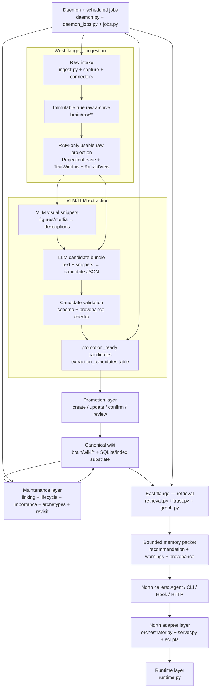
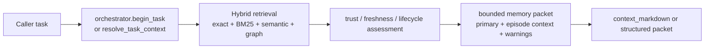
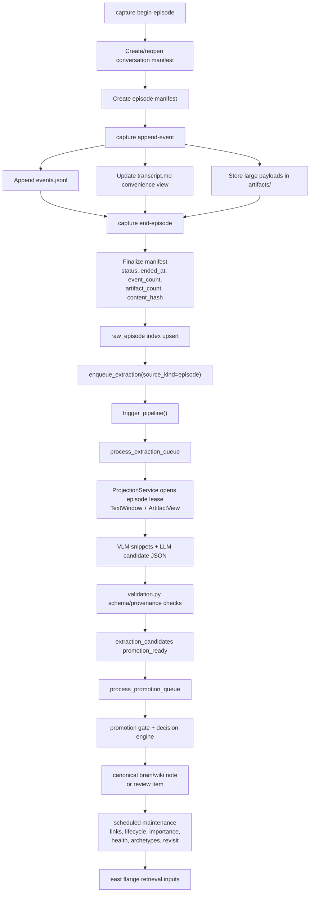

# MnemonicOS

> MnemonicOS is the memory contract an agent can trust, regardless of who built the agent.

MnemonicOS is a local-first, agent-independent memory runtime for agent workflows.
It is not tied to one agent shell or model. The core system owns true raw intake,
projection, VLM/LLM extraction, promotion, retrieval, and maintenance. Agent-facing
adapters sit on top as interface layers. See
[brain/system/product-boundary.md](brain/system/product-boundary.md) for what
MnemonicOS is not.

## System Shape



## Current Status

The active material-management path is feature-complete and release-gated:

```text
west flange intake
  -> projection lease
  -> VLM/LLM extraction
  -> promotion
  -> maintenance
  -> canonical wiki + graph/archetype/health state
```

The next architectural focus is the **east flange**: retrieval, context assembly,
explainability, and read-side serving over the canonical wiki, graph, archive
fallback, trust/freshness signals, and maintenance outputs.

Latest verification: `python3 -m unittest discover -s tests` passes with 343
tests, plus isolated end-to-end smoke checks for ingestion, promotion,
maintenance, raw re-visitation, and archetype graph propagation.

## Core Layers

- `brain/` — durable memory surface: system files, canonical notes, and raw archives.
- `runtime.py` — shared memory protocol: resolve context, record outcomes, decide writeback.
- `orchestrator.py` — agent interface layer: begin/fail/finish flows, context formatting.
- `server.py` — same operations over local HTTP.
- `ingest.py` — true raw intake and operational metadata.
- `projection/` — temporary in-memory usable raw as text windows and artifact views.
- `src/second_brain/extraction/` — VLM/LLM extraction queue, candidate store, validation.
- `src/second_brain/promotion/` — promotion gate, decisions, review routing, and wiki writes.
- `maintenance.py` — graph repair, lifecycle audit, importance scoring, health reports,
  pattern discovery, archetype persistence, and raw re-visitation.
- `retrieval.py`, `trust.py`, `graph.py` — current east-flange read path.
- `daemon.py`, `daemon_jobs.py`, `jobs.py` — extraction, promotion, backfill,
  maintenance, status, and queue cleanup on schedule.

## Ingestion Path

New material moves through five stages from raw intake to maintained canonical
memory:

1. **West flange intake**: submitted file is archived as immutable true raw under
   `brain/raw/`. Operational metadata (format, identity, duplicate state) is written.
   Exact duplicates short-circuit and skip projection.
2. **Projection**: `ProjectionService` opens a RAM-only lease yielding `TextWindow`
   objects (text lane) and `ArtifactView` objects (artifact lane). Nothing is
   persisted to disk at this stage.
3. **VLM/LLM extraction**: VLM describes figure payloads; combined text + visual
   snippets go to the LLM, which returns structured candidate JSON.
   `validation.py` checks schema, provenance, and evidence binding. Valid
   candidates reach `promotion_ready` status in `extraction_candidates`.
4. **Promotion**: promotion-ready candidates pass through gating and decision
   logic, then create, update, confirm, reject, or route notes to review.
   Accepted candidates become canonical markdown notes in `brain/wiki/`.
5. **Maintenance**: scheduled jobs keep the wiki usable after promotion: graph
   rebuilds, semantic neighbor links, cluster validation, lifecycle advancement,
   importance scoring, health overview publication, archetype persistence, and
   raw re-visitation when extraction schema/model drift makes a fresh pass useful.

### Maintenance Guarantees

- Raw re-visitation is ledger-safe: it inserts a fresh lineage-linked
  `extraction_queue` row and preserves the original queue row, candidates,
  promotion decisions, visual snippets, and extraction metadata.
- `wiki_health_report` writes `brain/wiki/overviews/maintenance.md` in live mode
  and stays read-only in dry-run mode.
- Pattern discovery persists confirmed archetypes in the `archetypes` table and
  annotates `graph_edges` with `archetype_id`, `archetype_score`, and
  `instance_confidence`.
- Daemon schedules include the maintenance jobs; the removed legacy
  `daily_consolidation` and `weekly_hygiene` jobs are no longer part of the
  runtime surface.

## Retrieval Path



What the fast path returns: primary memories, bounded episode context, warnings
for stale/contested/risky notes, and a recommendation (`reuse`,
`reuse_with_verification`, or `research_fresh`).

The east flange should treat ingestion, promotion, and maintenance outputs as
read-side inputs. Retrieval may record telemetry/eval traces, but it should not
mutate extraction or promotion ledgers.

## Agent Interface

Agents talk to MnemonicOS through the orchestrator facade:

- `begin_task`: infer task kind, build injectable context, return `task_id`
- `mark_failure`: record failed attempt, re-resolve context with same `task_id`
- `finish_task`: record outcome, return writeback decision

## Integration Surfaces

HTTP transport:

- `GET /v1/health`
- `POST /v1/retrieve`
- `POST /v1/ingest/session`
- `POST /v1/ingest/artifact`
- `POST /v1/reprocess/artifact`
- `POST /v1/capture/begin-episode`
- `POST /v1/capture/append-event`
- `POST /v1/capture/end-episode`
- `POST /v1/sync/vault`
- `POST /v1/jobs/run`
- `POST /v1/orchestrator/begin-task`
- `POST /v1/orchestrator/mark-failure`
- `POST /v1/orchestrator/finish-task`
- `POST /v1/extraction/queue`
- `POST /v1/extraction/process`
- `GET /v1/extraction/status`

## Install

```bash
./scripts/install_mnemonicos.sh
```

Installs `mnemonicos`, `mnemonicos-daemon`, and `mnemonicos-game`.

Config:

```bash
cp config/memory.example.toml config/memory.toml
```

## Main CLI

The CLI has two jobs:

1. Capture or ingest raw material into the west flange.
2. Inspect or manually drive the pipeline that turns that raw material into
   maintained canonical memory.

The key feature is the **capture API**. It is the bridge-facing path for agent
sessions and tool transcripts. Artifact ingest is the sibling path for files such
as PDFs, slides, docs, HTML, images, or markdown.

```bash
mnemonicos init-db
mnemonicos daemon start
mnemonicos daemon status
mnemonicos sync --mode full
mnemonicos orchestrator begin-task "debug the failing auth deploy"
mnemonicos ingest-artifact --file ./docs/paper.pdf --tag research --json
mnemonicos capture begin-episode --bridge-id codex --conversation-id thread-001 --episode-id visit-001
mnemonicos capture append-event --bridge-id codex --conversation-id thread-001 --episode-id visit-001 --type user_message --content "raw prompt"
mnemonicos capture end-episode --bridge-id codex --conversation-id thread-001 --episode-id visit-001 --status success
mnemonicos extraction-status
mnemonicos promote-status
mnemonicos retrieve "what do we know about the extraction queue?"
mnemonicos run-job wiki_health_report
mnemonicos run-job wiki_pattern_discovery
mnemonicos run-job wiki_raw_revisitation
mnemonicos server --host 127.0.0.1 --port 8000
mnemonicos-game --root /Users/jianyulong/ai_memory
```

What each command family does:

| Command | Use it for | Pipeline role |
|---|---|---|
| `init-db` | Apply SQLite migrations. | Prepares the database substrate. |
| `daemon start/status/run-job` | Run and inspect background work. | Executes scheduled cleanup and maintenance jobs. |
| `capture begin-episode` | Start a raw bridge episode for an agent conversation. | Creates/reopens the true-raw session container. |
| `capture append-event` | Append user, assistant, tool, or metadata events. | Extends the append-only raw truth log. |
| `capture end-episode` | Close the episode. | Commits metadata, hashes raw events, enqueues extraction, and triggers extraction/promotion. |
| `ingest-artifact` | Ingest a file or document artifact. | Archives immutable true raw, then enqueues and triggers extraction/promotion. |
| `reprocess-artifact` | Rerun extraction for repaired or previously failed artifacts. | Rewrites artifact projection state, re-enqueues extraction, and triggers downstream processing. |
| `ingest-session` | Import a prebuilt markdown session snapshot. | Archives session raw and enters the same extraction/promotion path. |
| `queue-extraction` | Manually queue a source. | Diagnostic/manual override; normal intake paths queue automatically. |
| `extraction-status` | Inspect extraction queue depth and row state. | Debugs west-flange-to-extraction handoff. |
| `promote-status` | Inspect promotion queue health. | Debugs candidate-to-wiki handoff. |
| `review` | Approve or reject routed notes. | Human gate for ambiguous promotion decisions. |
| `run-job` | Run a maintenance or queue job manually. | Operational diagnostics and repair. |
| `retrieve` / `resolve-task-context` | Query memory for a task. | East-flange read path. |
| `orchestrator begin-task/mark-failure/finish-task` | Agent workflow integration. | Wraps retrieval, outcome capture, and writeback decisions. |
| `server` | Start local HTTP transport. | Exposes the same operations over API. |
| `mnemonicos-game` | Visual/operator surface. | Lets a human inspect the memory system. |

Common scheduled jobs:

- `process_extraction_queue`
- `process_promotion_queue`
- `expire_stale_episodes`
- `embed_backfill`
- `wiki_embedding_neighbor_backfill`
- `wiki_cluster_validation`
- `wiki_pattern_discovery`
- `wiki_graph_rebuild`
- `wiki_lifecycle_audit`
- `wiki_importance_scoring`
- `wiki_health_report`
- `wiki_raw_revisitation`
- `status_report`

## West-Flange Artifact Ingest

```bash
mnemonicos ingest-artifact --file /path/to/artifact.pdf --tag research --json
```

Writes the file as immutable true raw:

```text
brain/raw/artifacts/{artifact}/
  original.pdf
  manifest.json
```

Projection Python example:

```python
from second_brain.projection import ProjectionService, SourceRef

service = ProjectionService(config)
lease = service.open_projection(SourceRef("artifact", archive_id="artifact/2026-05-04-paper"))

for window in service.iter_text_windows(lease.lease_id):
    ...  # TextWindow objects

for artifact in service.iter_artifacts(lease.lease_id):
    ...  # ArtifactView objects (figures, sidecars)

service.close_projection(lease.lease_id)
```

Duplicate-state handoff:

- `exact_duplicate`: thin redirect lease, no text windows, no payloads
- `canonical_duplicate` / `possible_duplicate` / `overlap_related`: project normally
- `unique`: normal projection

Reprocess failed ingests. Reprocessing accepted artifacts also re-enqueues
extraction so downstream extraction and promotion see repaired raw bytes:

```bash
mnemonicos reprocess-artifact --archive-id artifact/2026-04-27-161150-example --json
mnemonicos reprocess-artifact --failed --json
```

## Bridge Raw Capture

New bridges use the capture API for raw session recording. This is the primary
way an agent runtime hands MnemonicOS raw material. It writes directly to
`brain/raw/sessions/{conversation_id}/episodes/{episode_id}/` and, on
`end-episode`, pushes the material into the same ingestion pipeline as artifacts.

```bash
mnemonicos capture begin-episode \
  --bridge-id codex \
  --conversation-id codex-thread-abc \
  --episode-id 2026-04-27T163000+0800 \
  --json

mnemonicos capture append-event \
  --bridge-id codex \
  --conversation-id codex-thread-abc \
  --episode-id 2026-04-27T163000+0800 \
  --type user_message \
  --content "implement the bridge capture plan" \
  --json

mnemonicos capture end-episode \
  --bridge-id codex \
  --conversation-id codex-thread-abc \
  --episode-id 2026-04-27T163000+0800 \
  --status success \
  --json
```

### Capture Pipeline

When a bridge uses the capture API, this is the full path:



Detailed behavior:

1. `capture begin-episode` creates or reopens the conversation directory and an
   episode manifest. This is bookkeeping only; no interpretation happens.
2. `capture append-event` appends one raw event to `events.jsonl`. Small payloads
   stay inline; large payloads and sidecars are stored under `artifacts/`. A
   `transcript.md` convenience view may be updated, but `events.jsonl` remains the
   append-only raw truth.
3. `capture end-episode` appends an `episode_ended` event, computes the
   `content_hash`, updates episode and conversation manifests, and upserts the
   raw episode index.
4. `end_episode()` calls `enqueue_extraction()` with `source_kind="episode"`,
   `conversation_id`, `episode_id`, bridge/session metadata, and the event-log
   content hash.
5. If `[ingest].auto_trigger_pipeline = true` (the default), `trigger_pipeline()`
   immediately asks the daemon to run `process_extraction_queue` and then
   `process_promotion_queue`. If the daemon is not reachable, it runs both inline.
6. The extraction worker opens a projection lease over the captured episode. The
   west flange supplies temporary text windows and artifact views; it does not
   persist LLM/VLM interpretations.
7. VLM and LLM providers turn the projection into candidate JSON. Validation
   enforces schema, evidence binding, and provenance before rows become
   `promotion_ready`.
8. Promotion creates, updates, confirms, rejects, or routes review items. Accepted
   candidates become canonical notes in `brain/wiki/`.
9. Scheduled maintenance then keeps the wiki healthy: graph rebuilds, semantic
   neighbor links, cluster validation, lifecycle audit, importance scoring, health
   overview publication, archetype persistence, and raw re-visitation.
10. The east flange reads this maintained substrate for retrieval and context
    assembly.

Layout:

```text
brain/raw/sessions/{conversation_id}/
  manifest.json
  episodes/{episode_id}/
    manifest.json
    events.jsonl       ← append-only raw truth
    transcript.md      ← convenience view (user/assistant messages)
    artifacts/         ← payloads > 32 KB + sidecars
```

## Agent Adapters

**Claude Code**: hooks wired globally in `~/.claude/settings.json`. Both
`UserPromptSubmit` (begin_task) and `Stop` (finish_task) call the shared
orchestrator. See [brain/system/claude-bridge.md](brain/system/claude-bridge.md).

Disable for one session:

```bash
MNEMO_ENABLED=0 claude
```

Disable persistently:

```bash
touch config/mnemo_disabled
```

**Codex**: skill-based integration. Install:

```bash
scripts/install_codex_skill.sh
```

See [brain/system/codex-bridge.md](brain/system/codex-bridge.md). A hard-enforcement
wrapper (`mnemo-codex`) is planned but not yet implemented.

## Where To Look Next

- [brain/system/architecture.md](brain/system/architecture.md) — governing index
- [brain/system/runtime-protocol.md](brain/system/runtime-protocol.md) — runtime contract
- [brain/system/west-flange-development-plan.md](brain/system/west-flange-development-plan.md)
- [brain/system/llm-vlm-layer-development-plan.md](brain/system/llm-vlm-layer-development-plan.md)
- [brain/system/promotion-layer-plan.md](brain/system/promotion-layer-plan.md)
- [brain/system/knowledge-maintenance-development-plan.md](brain/system/knowledge-maintenance-development-plan.md)
- [brain/system/knowledge-maintenance-development-roadmap.md](brain/system/knowledge-maintenance-development-roadmap.md)
- [api/openapi.yaml](api/openapi.yaml)

## Verification

```bash
python3 -m unittest discover -s tests
```

The current readiness gate also includes isolated end-to-end checks for:

- artifact ingest through auto extraction and promotion
- maintenance jobs through health overview publication
- raw re-visitation through a second extraction/promotion pass with historical
  extraction and promotion rows preserved
- archetype persistence with graph-edge back-references
