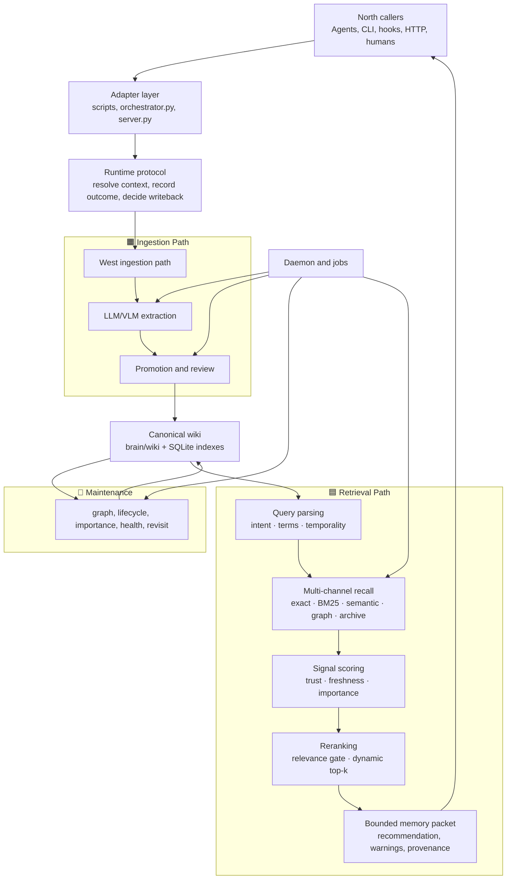
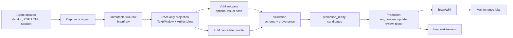
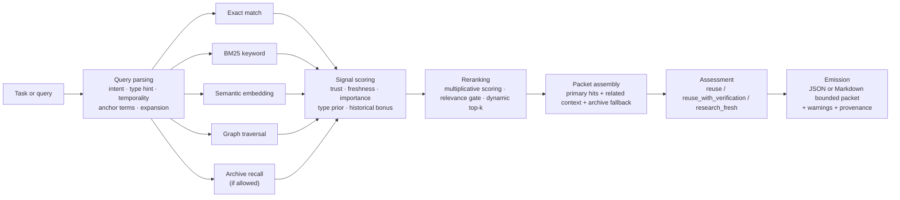
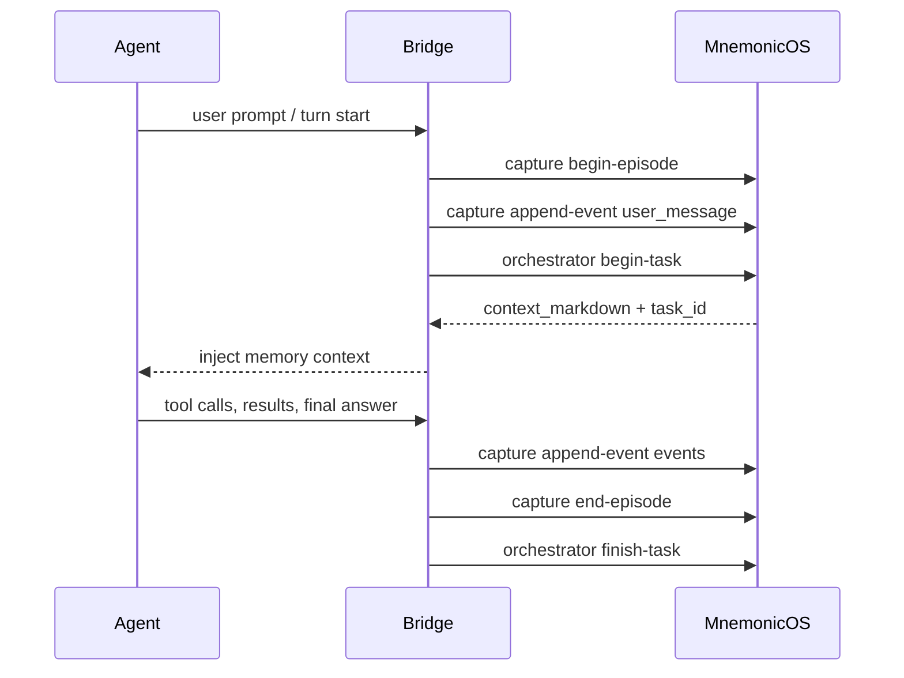

# MnemonicOS

> MnemonicOS is local-first memory infrastructure for agentic runtimes.

MnemonicOS gives agents a durable memory substrate that is independent of any
one model, IDE, shell, or vendor. It captures raw work, turns useful material
into governed notes, keeps those notes healthy, and returns bounded context to
agents and humans through CLI, hooks, and HTTP.

MnemonicOS is not an agent. It is the memory contract underneath agents.

## What It Is For

- Preserve true raw material from agent sessions, files, and tool activity.
- Convert raw material into validated, provenance-bound memory.
- Keep canonical memory useful through graph, lifecycle, importance, review,
  and re-visitation jobs.
- Serve context packets to agents before work, after failures, and during
  writeback decisions.
- Let different agents share one local memory vault without sharing one runtime.

See [Product Boundary](brain/system/product-boundary.md) for the scope rules and
[Architecture](brain/system/architecture.md) for the governing architecture
index.

## Architecture



Core modules:

| Layer | Main files | Purpose |
|---|---|---|
| Runtime and adapters | `runtime.py`, `orchestrator.py`, `server.py`, `scripts/` | Agent-facing protocol, hook scripts, HTTP transport. |
| Raw intake | `ingest.py`, `session_capture.py`, `connectors/` | Capture sessions and files as immutable true raw. |
| Projection | `projection/` | Build temporary text windows and artifact views from raw material. |
| Extraction | `extraction/` | Run VLM/LLM inference, validate candidate memory JSON. |
| Promotion | `promotion/` | Gate, decide, render, write, or route review items. |
| Maintenance | `maintenance.py`, `jobs.py`, `daemon.py` | Keep the wiki linked, scored, reviewed, and fresh. |
| Retrieval | `retrieval.py`, `query_parser.py`, `recall.py`, `reranker.py`, `emission.py` | Read-only context assembly and packet emission. |

Governing design docs:

- [Ingestion Path Governance](brain/system/INGESTION-PATH-GOVERNANCE-DESIGN.md)
- [Retrieval Path Governance](brain/system/RETRIEVAL-PATH-GOVERNANCE-DESIGN.md)
- [Runtime Protocol](brain/system/runtime-protocol.md)
- [Bridge Capture Plan](brain/system/ingestion-capture-plan.md)
- [West Flange Plan](brain/system/ingestion-west-flange-plan.md)
- [Extraction Plan](brain/system/ingestion-extraction-plan.md)
- [Promotion Plan](brain/system/ingestion-promotion-plan.md)
- [Maintenance Plan](brain/system/ingestion-maintenance-plan.md)
- [Retrieval Roadmap](brain/system/retrieval-development-roadmap.md)

## Ingestion Flow

Ingestion is the west side of MnemonicOS. It accepts raw material, preserves it,
projects it only temporarily, and lets deterministic gates decide what becomes
canonical memory.



Important invariants:

- `brain/raw/*` is witness material. It is preserved, not rewritten.
- Projection is temporary. It creates usable text/artifact views without making
  model interpretation authoritative.
- LLM/VLM output stops at validated candidates. It does not directly write wiki.
- Promotion is software-gated and ledgered.
- Ambiguous or conflicting material goes to human review.

## Retrieval Flow

Retrieval is the east side of MnemonicOS. It reads maintained memory and emits a
bounded packet for the caller.



Important invariants:

- Retrieval is read-only for memory content. It may write telemetry and feedback
  signals, but it does not mutate canonical notes.
- Recall strategies run across all channels; scores are merged before reranking.
- Archive recall is gated and only surfaces when wiki recall is insufficient.
- The recommendation in the emitted packet is binding for the caller protocol.

## Install

```bash
./scripts/install_mnemonicos.sh
cp config/memory.example.toml config/memory.toml
mnemonicos init-db
```

Installed commands:

- `mnemonicos`
- `mnemonicos-daemon`
- `mnemonicos-game`

The example config uses deterministic fixture/hash providers by default, so the
system can run tests and basic local workflows without external model services.

## Key CLI Commands

```bash
# database and sync
mnemonicos init-db
mnemonicos sync --mode full

# daemon
mnemonicos daemon start
mnemonicos daemon status
mnemonicos daemon run-job process_extraction_queue

# raw artifact ingestion
mnemonicos ingest-artifact --file ./docs/paper.pdf --tag research --json
mnemonicos reprocess-artifact --failed --json

# bridge capture
mnemonicos capture begin-episode --bridge-id codex --conversation-id thread-001 --episode-id turn-001 --json
mnemonicos capture append-event --bridge-id codex --conversation-id thread-001 --episode-id turn-001 --type user_message --content "raw prompt" --json
mnemonicos capture end-episode --bridge-id codex --conversation-id thread-001 --episode-id turn-001 --status success --json

# agent runtime facade
mnemonicos orchestrator begin-task "debug the failing deploy" --bridge-id codex --json
mnemonicos orchestrator mark-failure "pytest failed in retrieval tests" --bridge-id codex --session-id s1 --task-id t1 --json
mnemonicos orchestrator finish-task --bridge-id codex --session-id s1 --task-id t1 --status success --outcome-type coding --summary "Fixed retrieval tests." --json

# queues, review, retrieval
mnemonicos extraction-status
mnemonicos promote-status
mnemonicos review list
mnemonicos retrieve "what do we know about raw re-visitation?" --json
mnemonicos retrieve "what do we know about raw re-visitation?" --include-body --body-chars 4000 --json

# HTTP
mnemonicos server --host 127.0.0.1 --port 8000
```

Useful job names:

```text
process_extraction_queue
process_promotion_queue
expire_stale_episodes
embed_backfill
wiki_embedding_neighbor_backfill
wiki_cluster_validation
wiki_pattern_discovery
wiki_graph_rebuild
wiki_lifecycle_audit
wiki_importance_scoring
wiki_health_report
wiki_raw_revisitation
status_report
```

## Agent Adaptation

Agents should use the orchestrator facade and capture API rather than inventing
their own memory policy.



Start here:

- [Claude Code Bridge](docs/claude-code-bridge.md)
- [Codex Bridge From Scratch](docs/codex-bridge-from-scratch.md)
- [Claude bridge system note](brain/system/claude-bridge.md)
- [Codex bridge system note](brain/system/codex-bridge.md)

Minimum adapter contract:

1. Use a stable `bridge_id`.
2. Begin an episode at turn start.
3. Append raw events without rewriting previous events.
4. Call `orchestrator begin-task` before the model needs memory.
5. Call `orchestrator mark-failure` after the first meaningful failure.
6. End the episode and call `orchestrator finish-task` at completion.

## Inference Engine Adaptation

MnemonicOS separates model transport from memory policy. Configure providers in
`config/memory.toml`; the rest of the system still uses the same extraction,
validation, promotion, and retrieval contracts.

Provider roles:

- `models.llm`: candidate extraction from text windows and visual snippets.
- `models.vlm`: visual description for figures and image-heavy documents.
- `embeddings`: semantic retrieval and maintenance neighbor passes.

Default deterministic development config:

```toml
[embeddings]
enabled = true
provider = "hash"
model = "hash-256-v1"
dimensions = 256

[models.llm]
provider = "fixture"
model = "fixture-llm"

[models.vlm]
provider = "fixture"
model = "fixture-vlm"
```

### Ollama Example

Ollama exposes a local HTTP API, commonly on `http://127.0.0.1:11434`, and has
separate APIs for generation/chat and embeddings. MnemonicOS includes Ollama
provider adapters.

```bash
ollama pull qwen2.5:7b
ollama pull llama3.2-vision:latest
ollama pull nomic-embed-text
```

```toml
[models.llm]
provider = "ollama"
model = "qwen2.5:7b"
base_url = "http://127.0.0.1:11434"
timeout_seconds = 180

[models.vlm]
provider = "ollama"
model = "llama3.2-vision:latest"
base_url = "http://127.0.0.1:11434"
timeout_seconds = 180

[embeddings]
enabled = true
provider = "ollama_embeddings"
model = "nomic-embed-text"
dimensions = 768
base_url = "http://127.0.0.1:11434"
timeout_seconds = 60
```

### vLLM Example

vLLM can serve models through an OpenAI-compatible HTTP server. MnemonicOS uses
the `openai_compatible` and `openai_compatible_embeddings` providers for that
style of endpoint.

```bash
vllm serve Qwen/Qwen2.5-7B-Instruct --host 127.0.0.1 --port 8001
```

```toml
[models.llm]
provider = "openai_compatible"
model = "Qwen/Qwen2.5-7B-Instruct"
base_url = "http://127.0.0.1:8001/v1"
api_key_env = ""
timeout_seconds = 180

[models.vlm]
provider = "openai_compatible"
model = "your-vision-model"
base_url = "http://127.0.0.1:8001/v1"
api_key_env = ""
timeout_seconds = 180

[embeddings]
enabled = true
provider = "openai_compatible_embeddings"
model = "your-embedding-model"
dimensions = 1536
base_url = "http://127.0.0.1:8001/v1"
api_key_env = ""
timeout_seconds = 60
```

Use `api_key_env = "OPENAI_API_KEY"` or another environment variable name when
your endpoint requires authentication.

## HTTP Protocol

Start the local server:

```bash
mnemonicos server --host 127.0.0.1 --port 8000
```

Canonical schema:

- [api/openapi.yaml](api/openapi.yaml)

Endpoint groups:

| Endpoint | Purpose |
|---|---|
| `GET /v1/health` | Health and database readiness. |
| `POST /v1/retrieve` | Direct retrieval query. |
| `POST /v1/orchestrator/begin-task` | Agent preflight context packet. |
| `POST /v1/orchestrator/mark-failure` | Record failure and refresh context. |
| `POST /v1/orchestrator/finish-task` | Record outcome and compute writeback decision. |
| `POST /v1/capture/begin-episode` | Open raw capture episode. |
| `POST /v1/capture/append-event` | Append one raw event. |
| `POST /v1/capture/end-episode` | Finalize episode and enqueue downstream processing. |
| `POST /v1/ingest/session` | Archive markdown/session content. |
| `POST /v1/ingest/artifact` | Archive file artifact. |
| `POST /v1/reprocess/artifact` | Re-run artifact extraction. |
| `POST /v1/extraction/queue` | Manually queue extraction. |
| `POST /v1/extraction/process` | Process pending extraction rows. |
| `GET /v1/extraction/status` | Inspect extraction queue state. |
| `POST /v1/promotion/process` | Process promotion-ready candidates. |
| `GET /v1/promotion/status` | Inspect promotion queue state. |
| `POST /v1/sync/vault` | Sync markdown vault into indexes. |
| `POST /v1/jobs/run` | Run a named job. |

Example:

```bash
curl -s http://127.0.0.1:8000/v1/health

curl -s http://127.0.0.1:8000/v1/orchestrator/begin-task \
  -H 'Content-Type: application/json' \
  -d '{
    "bridge_id": "codex",
    "task_text": "debug the retrieval packet assembly",
    "session_id": "demo-session",
    "task_id": "demo-task"
  }'
```

## Repository Map

```text
api/                       OpenAPI protocol
brain/system/              governing architecture and plans
brain/raw/                 true raw sessions and artifacts
brain/wiki/                canonical memory and review queue
config/memory.example.toml default local config
docs/                      bridge and audit guides
migrations/                SQLite schema migrations
scripts/                   hook scripts and helper commands
src/second_brain/          MnemonicOS runtime
tests/                     unit and integration tests
```

## Verification

```bash
python3 -m unittest discover -s tests
```

Current local readiness check: 438 tests pass.

## External Inference References

- [Ollama API documentation](https://docs.ollama.com/api)
- [Ollama embeddings documentation](https://docs.ollama.com/capabilities/embeddings)
- [vLLM OpenAI-compatible server documentation](https://docs.vllm.ai/en/stable/serving/openai_compatible_server.html)
