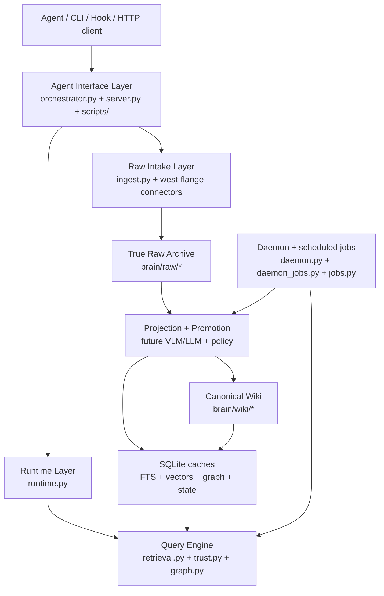
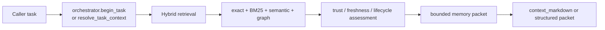
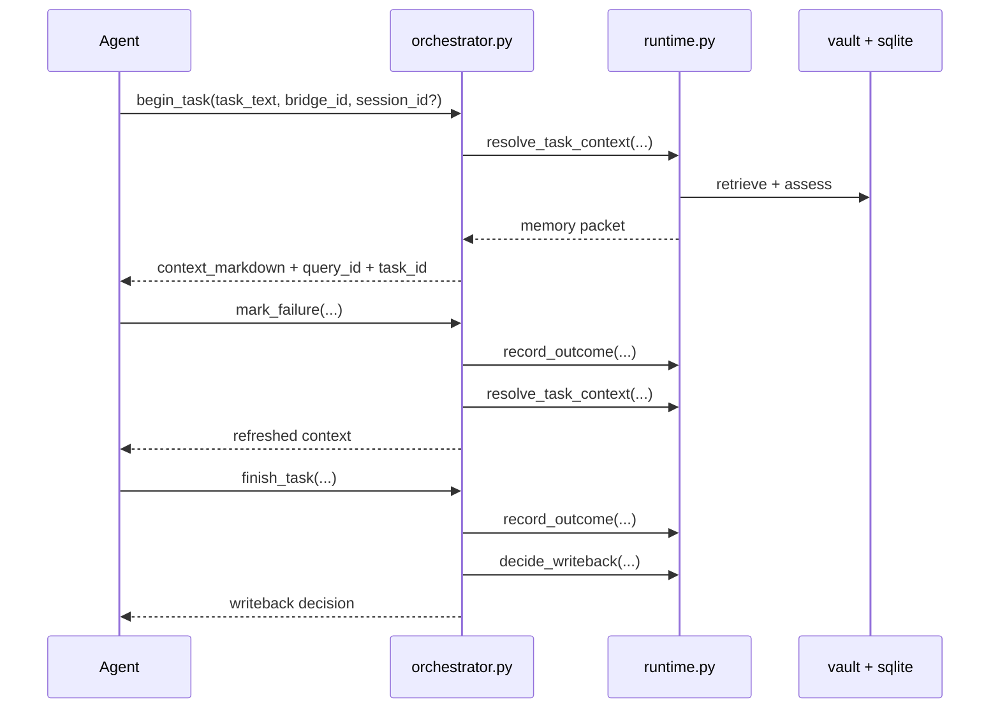
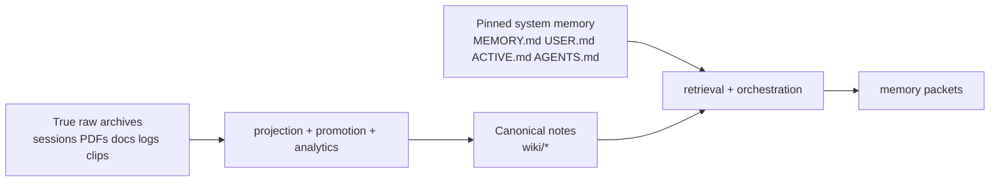
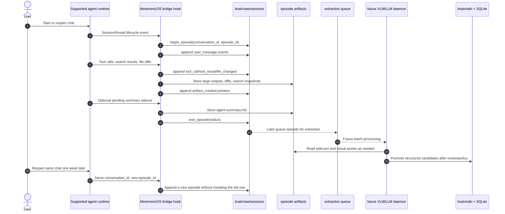

# MnemonicOS

> MnemonicOS is the memory contract an agent can trust, regardless of who built the agent.

MnemonicOS is a local-first, agent-independent memory runtime for agent workflows.

It is not tied to one agent shell or model. The core system owns true raw intake, storage, retrieval, runtime policy, promotion, and maintenance. Agent-facing adapters sit on top as interface layers. See [docs/boundary.md](docs/boundary.md) for what MnemonicOS is not (not a database, not an agent framework, not a memory library), and [development/roadmap-mnemonicos-competitive-positioning.md](development/roadmap-mnemonicos-competitive-positioning.md) for the competitive positioning.

The raw archive is intentionally broad. MnemonicOS should accept full agent sessions, PDFs, HTML, DOCX, Markdown, plain text, logs, web clips, code docs, and copied notes as true raw artifacts, then create rebuildable projections and selective canonical memory later. Agents may attach metadata, but they should not be required to pre-trim or reshape material before MnemonicOS archives it.

## System Shape



## Core Layers

- `brain/` is the durable memory surface: pinned system files, canonical notes, and raw archives.
- `runtime.py` is the shared memory protocol: resolve context, record outcomes, and decide writeback.
- `orchestrator.py` is the agent interface layer: it infers task shape, formats injected context, preserves `task_id`, and wraps the runtime into begin/fail/finish flows.
- `server.py` exposes the same operations over local HTTP.
- `ingest.py` owns true raw intake and operational metadata for sessions and artifacts.
- `artifact_identity.py` labels artifact redundancy without making semantic memory decisions.
- `projection/` exposes temporary in-memory usable raw as pull-based text windows and artifact views.
- `bridge.py` remains part of the legacy summary/promotion compatibility path; new bridges should prefer comprehensive raw capture.
- `daemon.py`, `daemon_jobs.py`, and `jobs.py` run projection, promotion, embedding backfill, and maintenance on schedule.

## Query Path

This is the request-time path used before or during an agent step.



What the fast path returns:

- primary memories
- bounded related context, including same-episode context when primary retrieval is strong
- warnings for stale, contested, or risky memories
- a recommendation such as `reuse`, `reuse_with_verification`, or `research_fresh`

## Store And Promotion Path

New material does not become canonical memory immediately by default.

```mermaid
flowchart LR
    A["Agent / human submits raw<br/>session events / PDF / HTML / DOCX / log / note"] --> B["west-flange intake"]
    B --> C["Immutable true raw archive<br/>original artifact + operational metadata"]
    C --> D["projection lease<br/>usable raw generated in memory"]
    D --> E["future VLM over figures<br/>in-memory context"]
    E --> F["future <=8B extraction LLM<br/>structured candidates"]
    F --> G["promotion policy<br/>candidate match / review / upsert decision"]
    G --> H["canonical markdown notes<br/>brain/wiki/*"]
    H --> I["sync + materializers"]
    I --> J["SQLite caches<br/>FTS + vectors + graph + trust state"]
```



Promotion rules in brief:

- preserve true raw first, project and promote later
- raw artifacts are witness material, not canonical truth
- agent/human write paths should actively store only true raw and operational metadata
- projections, canonical notes, and SQLite caches are daemon/materializer outputs
- legacy session summary intake may still create promotion queue candidates during migration
- promotion prefers updating an existing note or same-chain note when that is safer than creating duplicates

## Agent Interface Layer

Agents mostly talk to MnemonicOS through the orchestrator facade, not by stitching together low-level operations themselves.



This layer currently gives agents:

- `begin_task`: infer task kind, temporality, token budget, and build injectable context
- `mark_failure`: record a failed attempt and re-resolve context with the same `task_id`
- `finish_task`: record the final outcome and return a writeback decision

## Integration Surfaces

MnemonicOS has one core logical API and several transports/adapters around it.

Core logical API:

- runtime operations in `runtime.py`: `resolve_task_context`, `record_outcome`, `decide_writeback`, `run_maintenance`
- agent-facing orchestration in `orchestrator.py`: `begin_task`, `mark_failure`, `finish_task`

Common access paths:

- CLI: `mnemonicos ...`
- shared scripts in `scripts/`
- local HTTP server in `server.py`

HTTP transport:

- `GET /v1/health`
- `POST /v1/retrieve`
- `POST /v1/ingest/session`
- `POST /v1/ingest/artifact`
- `POST /v1/reprocess/artifact`
- `POST /v1/capture/begin-episode`
- `POST /v1/capture/append-event`
- `POST /v1/capture/end-episode`
- `POST /v1/sync/vault`
- `POST /v1/jobs/run`
- `POST /v1/orchestrator/begin-task`
- `POST /v1/orchestrator/mark-failure`
- `POST /v1/orchestrator/finish-task`

These mirror the same internal layers:

- query path: `/v1/retrieve`, `/v1/orchestrator/begin-task`, `/v1/orchestrator/mark-failure`
- store path: `/v1/capture/*`, `/v1/ingest/session`, `/v1/ingest/artifact`, `/v1/reprocess/artifact`, `/v1/orchestrator/finish-task`
- maintenance path: `/v1/sync/vault`, `/v1/jobs/run`

## Memory Surfaces



Practical rule:

- markdown is the canonical memory source of truth
- SQLite, vectors, graph, and state tables are rebuildable working indexes
- raw archives are broad, redundant witness material; canonical notes stay selective
- derived projections can be regenerated; raw artifacts should not be overwritten by agent-side summaries

## Key Components

- `src/second_brain/orchestrator.py`: agent-facing façade and context formatting
- `src/second_brain/runtime.py`: shared runtime protocol and packet assembly
- `src/second_brain/retrieval.py`: hybrid retrieval and reranking
- `src/second_brain/ingest.py`: archive intake and promotion helpers
- `src/second_brain/bridge.py`: summary parsing, chain inference, and candidate selection
- `src/second_brain/daemon_jobs.py`: cron schedule parsing and job registry
- `src/second_brain/jobs.py`: queue workers, backfill, consolidation, hygiene, status
- `src/second_brain/daemon.py`: Unix-socket daemon and service lifecycle
- `src/second_brain/server.py`: local HTTP transport

## How To Use

### Install once

From the repo root:

```bash
./scripts/install_mnemonicos.sh
```

This wrapper installs MnemonicOS and the Library RPG together.

What it installs:

- `mnemonicos`
- `mnemonicos-daemon`
- `mnemonicos-game`

What the wrapper runs internally:

```bash
python3 -m pip install -e ".[game]"
```

Config discovery is automatic:

- use `config/memory.toml` when it exists
- otherwise fall back to `config/memory.example.toml`
- pass `--config /path/to/file.toml` only when you want to override that

### Configuration

`config/memory.toml` is the local runtime configuration for your MnemonicOS workspace.

What it controls:

- storage locations such as the vault, SQLite DB, vectors, and graph directories
- retrieval behavior such as top-k, archive fallback, and rerank weights
- ingest behavior such as chunk size and archive defaults
- embedding, graph, and trust settings
- daemon socket, PID, logs, and scheduled jobs
- bridge-specific settings for agent integrations

Who uses it:

- `mnemonicos` reads it for all CLI operations
- `mnemonicos-daemon` reads it when starting the background daemon
- shared scripts in `scripts/` read it for hooks, retrieval helpers, and postflight ingest
- the local HTTP server uses it when started through `mnemonicos server`

When to use `config/memory.toml`:

- when you are actually running MnemonicOS in a real workspace
- when you want local paths, schedules, or settings that should not live in the checked-in example file
- when different machines or users need different local runtime settings

When `config/memory.example.toml` is enough:

- when you are evaluating the project quickly
- when the example paths and defaults already match your checkout
- as the template you copy from to create `config/memory.toml`

Typical setup:

```bash
cp config/memory.example.toml config/memory.toml
```

### Install the Game

The recommended install path is the wrapper:

```bash
./scripts/install_mnemonicos.sh
```

It installs both the core MnemonicOS commands and the game launcher in one step.

How to launch it:

```bash
mnemonicos-game
```

Safest launch command when you want to be explicit about which workspace the game should read:

```bash
mnemonicos-game --root /absolute/path/to/your/mnemonicos/workspace
```

For this repo specifically:

```bash
mnemonicos-game --root /Users/jianyulong/ai_memory
```

Quick verification:

```bash
mnemonicos-game --check
```

That prints the world summary without opening the game window, which is useful for confirming that the game sees the expected notes, system files, vault sessions, and daemon workspace.

If you want a standalone desktop app bundle instead of launching from the CLI:

```bash
./scripts/build_mnemonicos_game_app.sh
```

What the app-build script does:

- installs the package with the `game` extra
- installs `pyinstaller`
- builds a windowed app named `MnemonicOSLibraryRPG`

Build outputs:

- app bundle: `dist/MnemonicOSLibraryRPG`
- temporary build files: `build/`

Troubleshooting:

- If the game opens with empty shelves, no vault books, or a dormant daemon while your real MnemonicOS workspace has data, you are almost certainly pointing the game at the wrong workspace root.
- Run `mnemonicos-game --check --root /path/to/workspace` first and confirm the reported note/session counts match your real system.
- Reinstalling MnemonicOS is usually not necessary; fixing the workspace path is usually enough.

### Agent Adapters

Claude Code and Codex do not currently integrate with MnemonicOS in the same way.

Claude Code:

- the Claude hooks are wired globally through `~/.claude/settings.json`
- both the `claude` CLI and Claude Desktop use that same settings file
- once the hooks are installed, MnemonicOS behavior is available automatically in new Claude sessions
- restarting Claude Desktop is enough for hook changes to take effect

Codex:

- Codex uses the `mnemonicos-bridge` skill installed into `~/.codex/skills/` or `$CODEX_HOME/skills/`
- install or refresh it with:

```bash
scripts/install_codex_skill.sh
```

- after installing or refreshing the skill, starting a new Codex session is the safest way to pick it up
- if you use a custom `CODEX_HOME`, the installer and the Codex runtime must use the same `CODEX_HOME`
- the current Codex skill expects the repo-local shared scripts under `scripts/`
- in practice, Codex should be started in this repo, or in another workspace that also contains the same `scripts/mnemonic_*.sh` files

Current Codex caveat:

- the Codex skill is script-based, not hook-based
- that means the current MnemonicOS on/off switch does not fully disable direct Codex skill usage
- for Codex testing, disabling MnemonicOS currently means either not invoking the skill or running in a workspace where those shared scripts are not wired in

### Adapter Switch

The current MnemonicOS testing switch is implemented in the Claude hook adapters:

- `scripts/mnemonic_hook_preflight.sh`
- `scripts/mnemonic_stop_hook.sh`

It supports two mechanisms.

Persistent file flag:

```bash
touch config/mnemo_disabled
rm config/mnemo_disabled
```

Per-session environment variable:

```bash
MNEMO_ENABLED=0 claude
```

Behavior:

- when disabled, both Claude hooks exit `0` immediately
- retrieval is skipped
- writeback is skipped
- `MNEMO_ENABLED=0` takes precedence and is the cleaner per-session testing option

Practical summary:

- Claude normal use, CLI: run `claude`
- Claude normal use, Desktop: open the app
- Claude disable for one session: `MNEMO_ENABLED=0 claude`
- Claude disable persistently: create `config/mnemo_disabled`
- Claude re-enable: remove `config/mnemo_disabled`
- Codex normal use: install `mnemonicos-bridge`, start Codex in this repo, and invoke the skill
- Codex caveat: the current switch does not automatically disable direct skill/script calls

### Main CLI: installed entrypoints

Use this as the normal path after installation:

```bash
mnemonicos init-db
mnemonicos daemon start
mnemonicos daemon status
mnemonicos sync --mode full
mnemonicos orchestrator begin-task "debug the failing auth deploy"
mnemonicos capture begin-episode --bridge-id codex --conversation-id thread-001 --episode-id visit-001
mnemonicos ingest-session --bridge-id local-cli --session-id session-001 --file ./notes/session.md
mnemonicos ingest-artifact --file ./docs/paper.pdf --tag research
mnemonicos server --host 127.0.0.1 --port 8000
```

Daemon behavior:

- `mnemonicos daemon start` starts the daemon in the background
- `mnemonicos daemon status` checks whether the background daemon is reachable
- `mnemonicos daemon stop` stops the background daemon
- `mnemonicos-daemon` runs the daemon in the foreground in the current terminal

Foreground daemon entrypoint:

```bash
mnemonicos-daemon
```

### No-install fallback: Python module entrypoint

If you have not installed the package yet, the same CLI is available through the Python module:

```bash
PYTHONPATH=src python3 -m second_brain init-db
PYTHONPATH=src python3 -m second_brain daemon start
PYTHONPATH=src python3 -m second_brain sync --mode full
PYTHONPATH=src python3 -m second_brain orchestrator begin-task "debug the failing auth deploy"
```

`second_brain` is the internal Python package name. `mnemonicos` is the intended user-facing command.

### Bridge raw capture

New bridges should use the capture API for comprehensive raw session recording. This path writes directly under `brain/raw/sessions/{conversation_id}/episodes/{episode_id}/` and does not call the legacy `ingest-session` summary archive.

The target lifecycle for a supported agent looks like this:



```bash
mnemonicos capture begin-episode \
  --bridge-id codex \
  --conversation-id codex-thread-abc \
  --episode-id 2026-04-27T163000+0800 \
  --cwd "$PWD" \
  --agent-runtime codex \
  --json
```

Append completed turn and tool events as they happen:

```bash
mnemonicos capture append-event \
  --bridge-id codex \
  --conversation-id codex-thread-abc \
  --episode-id 2026-04-27T163000+0800 \
  --type user_message \
  --content "implement the bridge capture plan" \
  --json

mnemonicos capture append-event \
  --bridge-id codex \
  --conversation-id codex-thread-abc \
  --episode-id 2026-04-27T163000+0800 \
  --type tool_result \
  --payload-json '{"call_id":"shell-1","tool_name":"exec_command","output":"...","is_error":false}' \
  --json
```

End the episode when the bridge observes the run ending:

```bash
mnemonicos capture end-episode \
  --bridge-id codex \
  --conversation-id codex-thread-abc \
  --episode-id 2026-04-27T163000+0800 \
  --status success \
  --json
```

Project a captured episode into the promotion path without creating a duplicate raw archive:

```bash
mnemonicos capture project-episode \
  --conversation-id codex-thread-abc \
  --episode-id 2026-04-27T163000+0800 \
  --json
```

The resulting layout is:

```text
brain/raw/sessions/{conversation_id}/
  manifest.json
  episodes/{episode_id}/
    manifest.json
    events.jsonl
    transcript.md
    artifacts/
```

`events.jsonl` is append-only raw truth. `transcript.md` is a convenience view for user/assistant messages. Payloads larger than `MNEMOS_ARTIFACT_THRESHOLD_BYTES` defaulting to 32 KB are moved to `artifacts/` and referenced from the event line.

### West-flange artifact ingest

Use artifact ingest for PDFs, HTML/web clips, DOCX, PPTX, Markdown, plain text, logs, and similar true raw material:

```bash
mnemonicos ingest-artifact --file /path/to/artifact.pdf --tag research --json
```

This writes the submitted file as immutable true raw and records operational metadata:

```text
brain/raw/artifacts/{artifact}/
  original.pdf
  manifest.json
```

If you have source-provided companion files, such as separately downloaded figures from a paper, archive them as true raw attachments:

```bash
mnemonicos ingest-artifact \
  --file /path/to/paper.pdf \
  --attachment /path/to/figure1.png \
  --tag research \
  --json
```

Embedded/rendered figures extracted from PDFs, DOCX, or PPTX are not duplicated to disk by default. They are exposed as in-memory payloads through a projection lease, while only non-content figure metadata is persisted.

West-flange v1 now has three layers:

- **Intake/archive**: `ingest_artifact()` preserves true raw, writes `manifest.json`, and persists only operational metadata.
- **Identity/redundancy**: `artifact_identity.py` records `duplicate_state`, `canonical_archive_id`, normalized identity fingerprints, and SimHash LSH buckets. Exact byte duplicates create a submission row only and short-circuit connector/projection work. Canonical, possible, and overlap-related duplicates remain projection-eligible.
- **Projection/artifact lane**: `ProjectionService` opens temporary in-process leases. It yields `TextWindow` objects and `ArtifactView` objects, with marker links such as `[FIGURE: fig_003 ...]`. Usable raw text, extracted figure payload bytes, OCR text, captions, VLM descriptions, and LLM interpretations are still not persisted as west-flange metadata.

Python projection example:

```python
from second_brain.projection import ProjectionService, SourceRef

service = ProjectionService(config)
lease = service.open_projection(SourceRef("artifact", archive_id="artifact/2026-05-04-paper"))

for window in service.iter_text_windows(lease.lease_id):
    ...

for artifact in service.iter_artifacts(lease.lease_id):
    ...

service.close_projection(lease.lease_id)
```

Duplicate-state handoff:

- `exact_duplicate`: returns a thin redirect lease with `canonical_source_ref`, no text windows, and no payloads.
- `canonical_duplicate`: projects normally and carries `canonical_source_ref`.
- `possible_duplicate`: projects normally and leaves review/merge judgment to downstream extraction.
- `overlap_related`: projects normally and preserves unique delta content.
- `unique`: normal projection.

Artifact ingest intentionally does **not** create `archive_chunks`; normal retrieval should not inject true raw or usable raw artifact content. Check that invariant with:

```bash
sqlite3 brain/data/archive.db \
  "select count(*) from archive_chunks where archive_id like 'artifact/%';"
```

If extraction fails because an optional parser is missing or the artifact has no extractable text, true raw is still retained and marked repairable:

```bash
sqlite3 brain/data/archive.db \
  "select id, source_format, ingest_status, failure_reason from archive where id like 'artifact/%' order by ingested_at desc limit 5;"
```

After installing a missing parser or manually repairing a preserved raw artifact, reprocess the same archive id instead of ingesting a duplicate:

```bash
mnemonicos reprocess-artifact --archive-id artifact/2026-04-27-161150-example --json
```

To retry all failed artifact ingests:

```bash
mnemonicos reprocess-artifact --failed --json
```

Reprocessing updates the same `archive` row, rewrites `manifest.json`, replaces figure metadata, and still does not create artifact chunks. Reprocessing exact or canonical duplicate rows redirects to canonical metadata instead of duplicating raw bytes or rerunning Stage 0.

The west flange deliberately stops before model extraction. The next layer should consume `ProjectionLease`, send `ArtifactView` payloads or source attachments to a VLM, combine temporary visual snippets with `TextWindow` content for the extraction LLM, and persist only structured candidates, review items, promotion decisions, and allowed operational metadata.

### API entrypoints

Start the local API server:

```bash
mnemonicos server --host 127.0.0.1 --port 8000
```

The canonical HTTP endpoint list is in **Integration Surfaces** above and the schema lives in `api/openapi.yaml`.

## Where To Look Next

- [docs/RUNTIME_PROTOCOL.md](docs/RUNTIME_PROTOCOL.md)
- [api/openapi.yaml](api/openapi.yaml)
- [src/second_brain/orchestrator.py](src/second_brain/orchestrator.py)
- [src/second_brain/runtime.py](src/second_brain/runtime.py)
- [src/second_brain/ingest.py](src/second_brain/ingest.py)
- [src/second_brain/jobs.py](src/second_brain/jobs.py)
