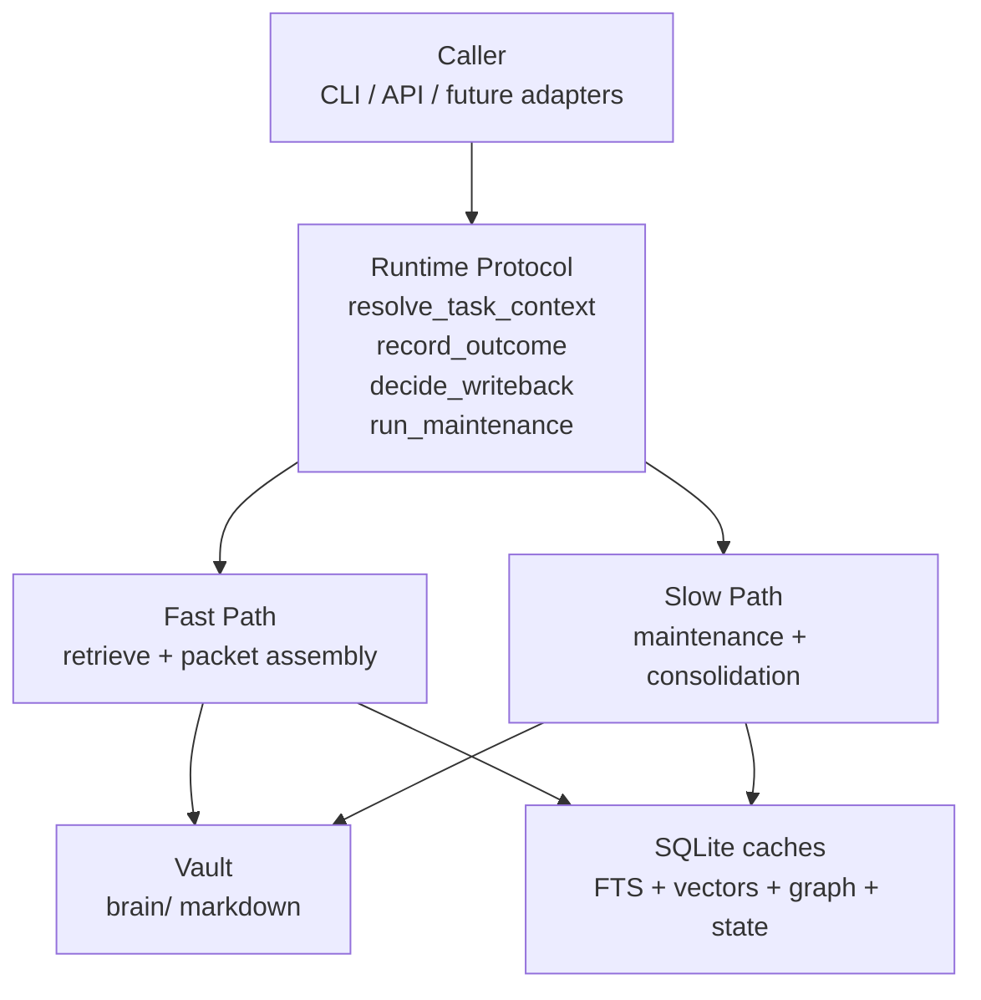
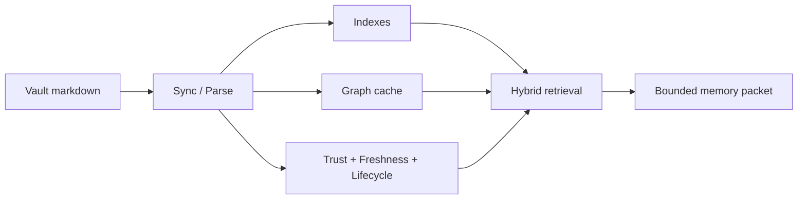
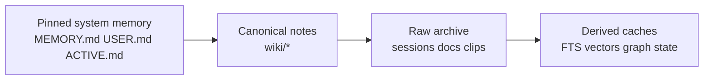
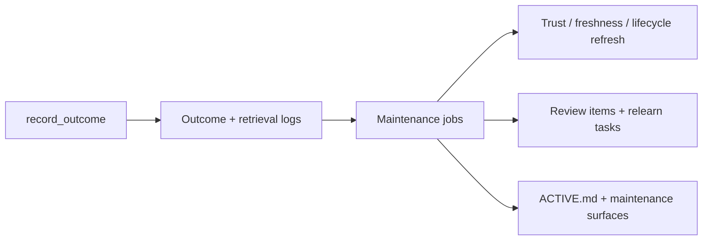
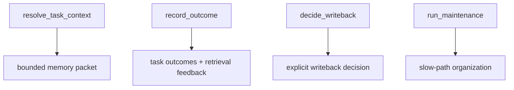
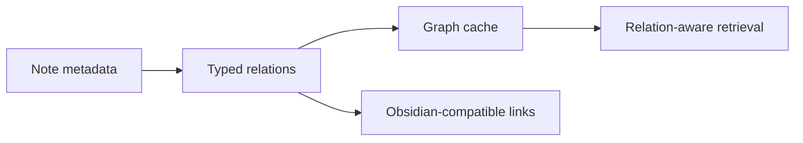
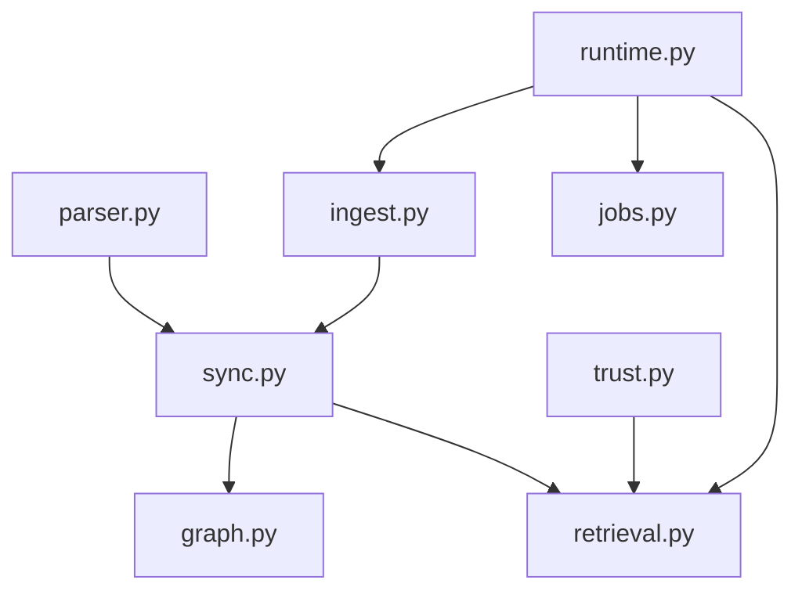

# MnemonicOS

MnemonicOS is a standalone memory system for LLM workflows.

It is not an agent plugin pretending to be a product. It is a local, model-agnostic memory runtime with its own storage model, retrieval path, maintenance path, and runtime protocol. Agents may call it, but they do not define it.

What makes it special:

- standalone and agent-independent: the memory system is canonical; adapters are secondary
- two-speed architecture: fast path for request-time context, slow path for consolidation and self-organization
- graph and state aware: memories carry links, freshness, lifecycle, and trust signals
- self-evolving: outcomes, maintenance jobs, and review queues improve memory quality over time
- Obsidian-friendly: markdown remains the source of truth, with built-in support for Obsidian-compatible links and properties

## System Shape





## How To Use

Current canonical usage is local and direct. Adapter workflows are not yet the primary UX.

1. Initialize the database.
2. Sync the vault.
3. Ingest durable session summaries or notes.
4. Resolve task context or run retrieval directly.
5. Record outcomes and decide writeback explicitly when appropriate.
6. Run maintenance jobs to refresh and organize memory.

### CLI

```bash
PYTHONPATH=src python3 -m second_brain init-db
PYTHONPATH=src python3 -m second_brain sync --mode full
PYTHONPATH=src python3 -m second_brain ingest-session --bridge-id local-cli --session-id session-001 --file ./notes/session.md
PYTHONPATH=src python3 -m second_brain resolve-task-context "how do we deploy auth service" \
  --bridge-id local-cli \
  --session-id session-001 \
  --task-id task-001 \
  --task-kind coding \
  --temporality current \
  --json
PYTHONPATH=src python3 -m second_brain record-outcome \
  --bridge-id local-cli \
  --session-id session-001 \
  --task-id task-001 \
  --outcome-type task_result \
  --status success \
  --summary "Used existing deploy memory successfully." \
  --json
PYTHONPATH=src python3 -m second_brain decide-writeback \
  --bridge-id local-cli \
  --session-id session-001 \
  --task-id task-001 \
  --note-type procedure \
  --title "Deploy Auth Service" \
  --summary-text "Refined deploy checklist after successful run." \
  --json
PYTHONPATH=src python3 -m second_brain run-job daily_consolidation
PYTHONPATH=src python3 -m second_brain run-job weekly_hygiene
```

## Memory Model

MnemonicOS keeps markdown as the source of truth and treats all derived structures as rebuildable caches.



Durable note kinds:

- `person`
- `project`
- `repo`
- `decision`
- `procedure`
- `concept`
- `incident`
- `source`
- `journal`
- `overview`

Additional semantic layers:

- overlay class: `fact`, `episode`
- lifecycle state: `draft`, `review`, `verified`, `canonical`, `contested`, `archived`
- freshness state: `fresh`, `aging`, `suspect`, `stale`, `contested`

Key rule:

- lifecycle answers authority
- freshness answers temporal safety

## Fast Path

The fast path is what a caller uses while doing work.


The packet is bounded and policy-aware, not just a ranked list.

Packet shape:

- `primary_memories`
- `related_by_topic`
- `related_by_timeline`
- `related_by_similarity`
- `related_by_contrast`
- `warnings`
- `verification_needed`

Recommendations:

- `reuse`
- `reuse_with_verification`
- `research_fresh`

## Slow Path

The slow path improves the system over time.



This path is responsible for:

- duplicate control
- contradiction surfacing
- trust and usefulness updates
- freshness recomputation
- review and relearn generation
- longer-horizon memory refinement

## Runtime Protocol

MnemonicOS exposes a unified runtime protocol independent of any specific agent.



Canonical operations:

- `resolve_task_context`
- `record_outcome`
- `decide_writeback`
- `run_maintenance`

The protocol is documented in [docs/RUNTIME_PROTOCOL.md](/Users/jianyulong/ai_memory/docs/RUNTIME_PROTOCOL.md:1).

## Memory Linking And Obsidian

MnemonicOS treats memory as a multi-relational graph.



Important rules:

- MnemonicOS semantic relations are canonical
- graph edges are rebuildable caches
- Obsidian links and properties are compatibility and visualization layers
- if a relation should appear in Obsidian-native graph or link views, it should also be represented in an Obsidian-compatible form

This means the system can stay semantically richer than Obsidian while still remaining pleasant to inspect and navigate inside an Obsidian vault.

## Key Components



Component roles:

- `runtime.py`: unified runtime operations and packet assembly
- `parser.py`: note parsing, lifecycle/overlay/typed-relation extraction
- `sync.py`: markdown to SQLite/cache materialization
- `ingest.py`: raw-first ingest and durable note projection
- `graph.py`: rebuildable typed-link graph
- `retrieval.py`: hybrid retrieval and reranking
- `trust.py`: trust, freshness, and lifecycle-aware caution signals
- `jobs.py`: slow-path maintenance and consolidation

## Current State

Implemented now:

- unified runtime protocol in code
- bounded memory packets
- shared outcome recording and writeback decisioning
- typed relations and lifecycle fields in durable notes
- Obsidian-compatible relation projection
- lifecycle-aware and freshness-aware runtime warnings
- maintenance-driven trust and freshness updates

Verified by the current test suite:

```bash
python3 -m unittest discover -s tests
```

## Where To Look Next

- [docs/RUNTIME_PROTOCOL.md](/Users/jianyulong/ai_memory/docs/RUNTIME_PROTOCOL.md:1)
- [plan-mnemonicOSImprovement.prompt.md](/Users/jianyulong/ai_memory/plan-mnemonicOSImprovement.prompt.md:1)
- [src/second_brain/runtime.py](/Users/jianyulong/ai_memory/src/second_brain/runtime.py:1)
- [src/second_brain/ingest.py](/Users/jianyulong/ai_memory/src/second_brain/ingest.py:1)
- [src/second_brain/retrieval.py](/Users/jianyulong/ai_memory/src/second_brain/retrieval.py:1)
