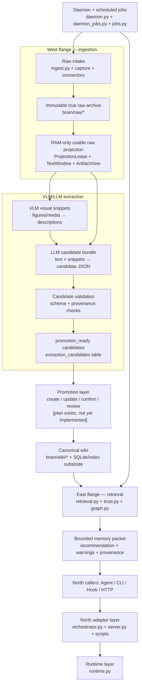
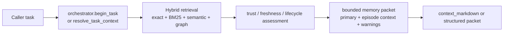

# MnemonicOS

> MnemonicOS is the memory contract an agent can trust, regardless of who built the agent.

MnemonicOS is a local-first, agent-independent memory runtime for agent workflows.
It is not tied to one agent shell or model. The core system owns true raw intake,
projection, VLM/LLM extraction, promotion, retrieval, and maintenance. Agent-facing
adapters sit on top as interface layers. See
[brain/system/product-boundary.md](brain/system/product-boundary.md) for what
MnemonicOS is not.

## System Shape



## Core Layers

- `brain/` — durable memory surface: system files, canonical notes, and raw archives.
- `runtime.py` — shared memory protocol: resolve context, record outcomes, decide writeback.
- `orchestrator.py` — agent interface layer: begin/fail/finish flows, context formatting.
- `server.py` — same operations over local HTTP.
- `ingest.py` — true raw intake and operational metadata.
- `projection/` — temporary in-memory usable raw as text windows and artifact views.
- `src/second_brain/extraction/` — VLM/LLM extraction queue, candidate store, validation.
- `daemon.py`, `daemon_jobs.py`, `jobs.py` — extraction, backfill, maintenance on schedule.

## Ingestion Path

New material goes through four stages before becoming canonical memory:

1. **West flange intake**: submitted file is archived as immutable true raw under
   `brain/raw/`. Operational metadata (format, identity, duplicate state) is written.
   Exact duplicates short-circuit and skip projection.
2. **Projection**: `ProjectionService` opens a RAM-only lease yielding `TextWindow`
   objects (text lane) and `ArtifactView` objects (artifact lane). Nothing is
   persisted to disk at this stage.
3. **VLM/LLM extraction**: VLM describes figure payloads; combined text + visual
   snippets go to the LLM, which returns structured candidate JSON.
   `validation.py` checks schema, provenance, and evidence binding. Valid
   candidates reach `promotion_ready` status in `extraction_candidates`.
4. **Promotion** *(plan exists, not yet implemented)*: promotion-ready candidates
   become canonical markdown notes in `brain/wiki/`.

## Retrieval Path



What the fast path returns: primary memories, bounded episode context, warnings
for stale/contested/risky notes, and a recommendation (`reuse`,
`reuse_with_verification`, or `research_fresh`).

## Agent Interface

Agents talk to MnemonicOS through the orchestrator facade:

- `begin_task`: infer task kind, build injectable context, return `task_id`
- `mark_failure`: record failed attempt, re-resolve context with same `task_id`
- `finish_task`: record outcome, return writeback decision

## Integration Surfaces

HTTP transport:

- `GET /v1/health`
- `POST /v1/retrieve`
- `POST /v1/ingest/session`
- `POST /v1/ingest/artifact`
- `POST /v1/reprocess/artifact`
- `POST /v1/capture/begin-episode`
- `POST /v1/capture/append-event`
- `POST /v1/capture/end-episode`
- `POST /v1/sync/vault`
- `POST /v1/jobs/run`
- `POST /v1/orchestrator/begin-task`
- `POST /v1/orchestrator/mark-failure`
- `POST /v1/orchestrator/finish-task`
- `POST /v1/extraction/queue`
- `POST /v1/extraction/process`
- `GET /v1/extraction/status`

## Install

```bash
./scripts/install_mnemonicos.sh
```

Installs `mnemonicos`, `mnemonicos-daemon`, and `mnemonicos-game`.

Config:

```bash
cp config/memory.example.toml config/memory.toml
```

## Main CLI

```bash
mnemonicos init-db
mnemonicos daemon start
mnemonicos daemon status
mnemonicos sync --mode full
mnemonicos orchestrator begin-task "debug the failing auth deploy"
mnemonicos ingest-artifact --file ./docs/paper.pdf --tag research --json
mnemonicos capture begin-episode --bridge-id codex --conversation-id thread-001 --episode-id visit-001
mnemonicos extraction-status
mnemonicos server --host 127.0.0.1 --port 8000
mnemonicos-game --root /Users/jianyulong/ai_memory
```

## West-Flange Artifact Ingest

```bash
mnemonicos ingest-artifact --file /path/to/artifact.pdf --tag research --json
```

Writes the file as immutable true raw:

```text
brain/raw/artifacts/{artifact}/
  original.pdf
  manifest.json
```

Projection Python example:

```python
from second_brain.projection import ProjectionService, SourceRef

service = ProjectionService(config)
lease = service.open_projection(SourceRef("artifact", archive_id="artifact/2026-05-04-paper"))

for window in service.iter_text_windows(lease.lease_id):
    ...  # TextWindow objects

for artifact in service.iter_artifacts(lease.lease_id):
    ...  # ArtifactView objects (figures, sidecars)

service.close_projection(lease.lease_id)
```

Duplicate-state handoff:

- `exact_duplicate`: thin redirect lease, no text windows, no payloads
- `canonical_duplicate` / `possible_duplicate` / `overlap_related`: project normally
- `unique`: normal projection

Reprocess failed ingests:

```bash
mnemonicos reprocess-artifact --archive-id artifact/2026-04-27-161150-example --json
mnemonicos reprocess-artifact --failed --json
```

## Bridge Raw Capture

New bridges use the capture API for raw session recording — writes directly to
`brain/raw/sessions/{conversation_id}/episodes/{episode_id}/`.

```bash
mnemonicos capture begin-episode \
  --bridge-id codex \
  --conversation-id codex-thread-abc \
  --episode-id 2026-04-27T163000+0800 \
  --json

mnemonicos capture append-event \
  --bridge-id codex \
  --conversation-id codex-thread-abc \
  --episode-id 2026-04-27T163000+0800 \
  --type user_message \
  --content "implement the bridge capture plan" \
  --json

mnemonicos capture end-episode \
  --bridge-id codex \
  --conversation-id codex-thread-abc \
  --episode-id 2026-04-27T163000+0800 \
  --status success \
  --json
```

Layout:

```text
brain/raw/sessions/{conversation_id}/
  manifest.json
  episodes/{episode_id}/
    manifest.json
    events.jsonl       ← append-only raw truth
    transcript.md      ← convenience view (user/assistant messages)
    artifacts/         ← payloads > 32 KB + sidecars
```

## Agent Adapters

**Claude Code**: hooks wired globally in `~/.claude/settings.json`. Both
`UserPromptSubmit` (begin_task) and `Stop` (finish_task) call the shared
orchestrator. See [brain/system/claude-bridge.md](brain/system/claude-bridge.md).

Disable for one session:

```bash
MNEMO_ENABLED=0 claude
```

Disable persistently:

```bash
touch config/mnemo_disabled
```

**Codex**: skill-based integration. Install:

```bash
scripts/install_codex_skill.sh
```

See [brain/system/codex-bridge.md](brain/system/codex-bridge.md). A hard-enforcement
wrapper (`mnemo-codex`) is planned but not yet implemented.

## Where To Look Next

- [brain/system/architecture.md](brain/system/architecture.md) — governing index
- [brain/system/runtime-protocol.md](brain/system/runtime-protocol.md) — runtime contract
- [brain/system/west-flange-development-plan.md](brain/system/west-flange-development-plan.md)
- [brain/system/llm-vlm-layer-development-plan.md](brain/system/llm-vlm-layer-development-plan.md)
- [brain/system/promotion-layer-plan.md](brain/system/promotion-layer-plan.md) — next layer stub
- [api/openapi.yaml](api/openapi.yaml)
