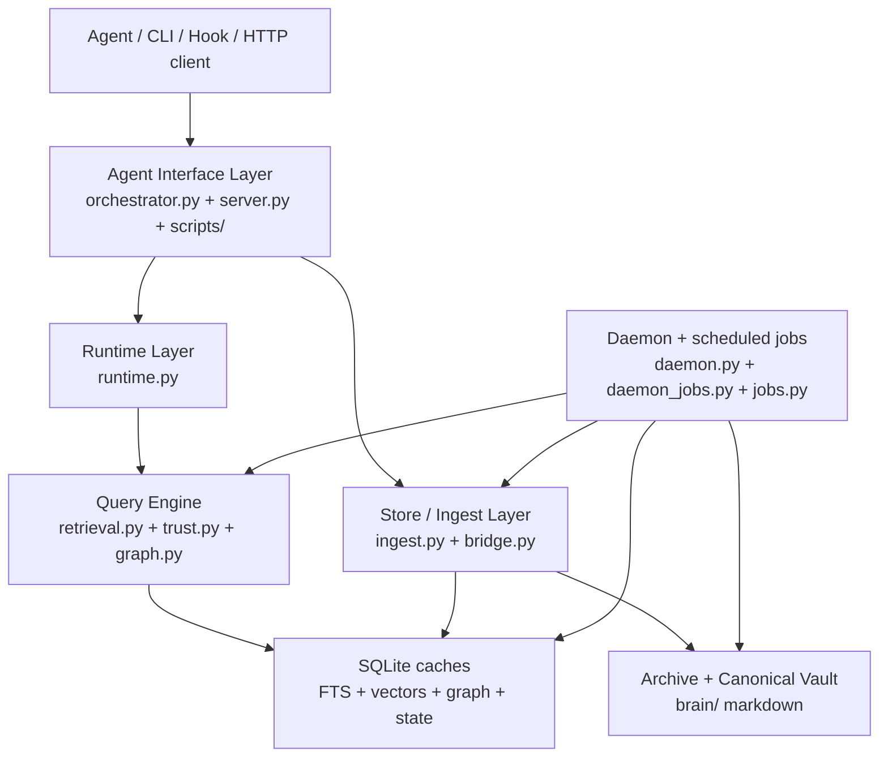
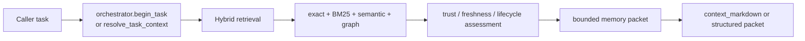
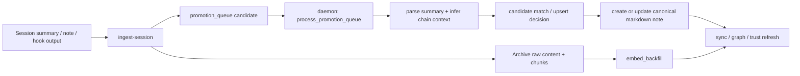
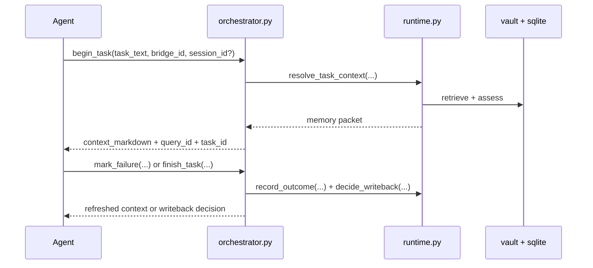
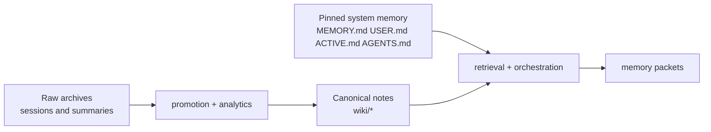

# MnemonicOS

MnemonicOS is a local-first memory runtime for agent workflows.

It is not tied to one agent shell or model. The core system owns storage, retrieval, runtime policy, promotion, and maintenance. Agent-facing adapters sit on top as interface layers.

## System Shape



## Core Layers

- `brain/` is the durable memory surface: pinned system files, canonical notes, and raw archives.
- `runtime.py` is the shared memory protocol: resolve context, record outcomes, and decide writeback.
- `orchestrator.py` is the agent interface layer: it infers task shape, formats injected context, preserves `task_id`, and wraps the runtime into begin/fail/finish flows.
- `server.py` exposes the same operations over local HTTP.
- `ingest.py` and `bridge.py` handle archive intake, summary parsing, candidate matching, and promotion decisions.
- `daemon.py`, `daemon_jobs.py`, and `jobs.py` run deferred promotion, embedding backfill, and maintenance on schedule.

## Query Path

This is the request-time path used before or during an agent step.



What the fast path returns:

- primary memories
- bounded related context, including same-episode context when primary retrieval is strong
- warnings for stale, contested, or risky memories
- a recommendation such as `reuse`, `reuse_with_verification`, or `research_fresh`

## Store And Promotion Path

New material does not become canonical memory immediately by default.



Promotion rules in brief:

- archive first, promote later
- default intake creates a queue candidate instead of immediate canonical memory
- `--promote-now` exists for manual or debug use, not the normal path
- promotion prefers updating an existing note or same-chain note when that is safer than creating duplicates

## Agent Interface Layer

The current README needed this layer called out explicitly: agents mostly talk to MnemonicOS through the orchestrator facade, not by stitching together low-level operations themselves.



This layer currently gives agents:

- `begin_task`: infer task kind, temporality, token budget, and build injectable context
- `mark_failure`: record a failed attempt and re-resolve context with the same `task_id`
- `finish_task`: record the final outcome and return a writeback decision

## API Surface

Local HTTP endpoints in `api/openapi.yaml` and `server.py`:

- `GET /v1/health`
- `POST /v1/retrieve`
- `POST /v1/ingest/session`
- `POST /v1/sync/vault`
- `POST /v1/jobs/run`
- `POST /v1/orchestrator/begin-task`
- `POST /v1/orchestrator/mark-failure`
- `POST /v1/orchestrator/finish-task`

These mirror the same internal layers:

- query path: `/v1/retrieve`, `/v1/orchestrator/begin-task`, `/v1/orchestrator/mark-failure`
- store path: `/v1/ingest/session`, `/v1/orchestrator/finish-task`
- maintenance path: `/v1/sync/vault`, `/v1/jobs/run`

## Memory Surfaces



Practical rule:

- markdown is the source of truth
- SQLite, vectors, graph, and state tables are rebuildable working indexes
- raw archives are broad history; canonical notes stay selective

## Key Components

- `src/second_brain/orchestrator.py`: agent-facing façade and context formatting
- `src/second_brain/runtime.py`: shared runtime protocol and packet assembly
- `src/second_brain/retrieval.py`: hybrid retrieval and reranking
- `src/second_brain/ingest.py`: archive intake and promotion helpers
- `src/second_brain/bridge.py`: summary parsing, chain inference, and candidate selection
- `src/second_brain/jobs.py`: queue workers, backfill, consolidation, hygiene, status
- `src/second_brain/daemon.py`: Unix-socket daemon and scheduler
- `src/second_brain/server.py`: local HTTP transport

## Minimal Usage

```bash
PYTHONPATH=src python3 -m second_brain init-db
PYTHONPATH=src python3 -m second_brain daemon start
PYTHONPATH=src python3 -m second_brain sync --mode full
PYTHONPATH=src python3 -m second_brain orchestrator begin-task "debug the failing auth deploy"
PYTHONPATH=src python3 -m second_brain ingest-session --bridge-id local-cli --session-id session-001 --file ./notes/session.md
PYTHONPATH=src python3 -m second_brain daemon run-job process_promotion_queue
PYTHONPATH=src python3 -m second_brain server --host 127.0.0.1 --port 8000
```

Installed entrypoints:

- `mnemonicos`
- `mnemonicos-daemon`

## Where To Look Next

- [docs/RUNTIME_PROTOCOL.md](/Users/jianyulong/ai_memory/docs/RUNTIME_PROTOCOL.md:1)
- [api/openapi.yaml](/Users/jianyulong/ai_memory/api/openapi.yaml:1)
- [src/second_brain/orchestrator.py](/Users/jianyulong/ai_memory/src/second_brain/orchestrator.py:1)
- [src/second_brain/runtime.py](/Users/jianyulong/ai_memory/src/second_brain/runtime.py:1)
- [src/second_brain/ingest.py](/Users/jianyulong/ai_memory/src/second_brain/ingest.py:1)
- [src/second_brain/jobs.py](/Users/jianyulong/ai_memory/src/second_brain/jobs.py:1)
