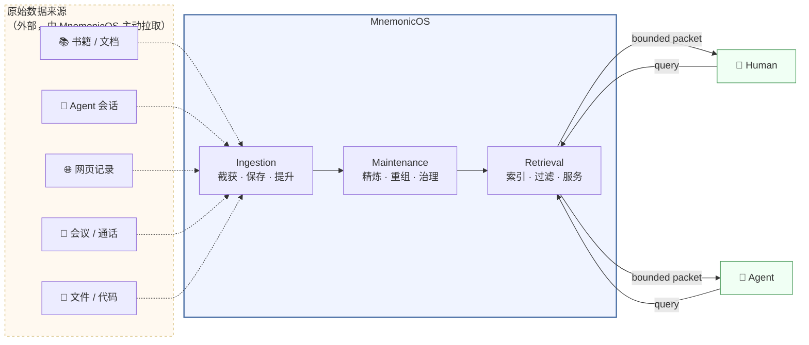
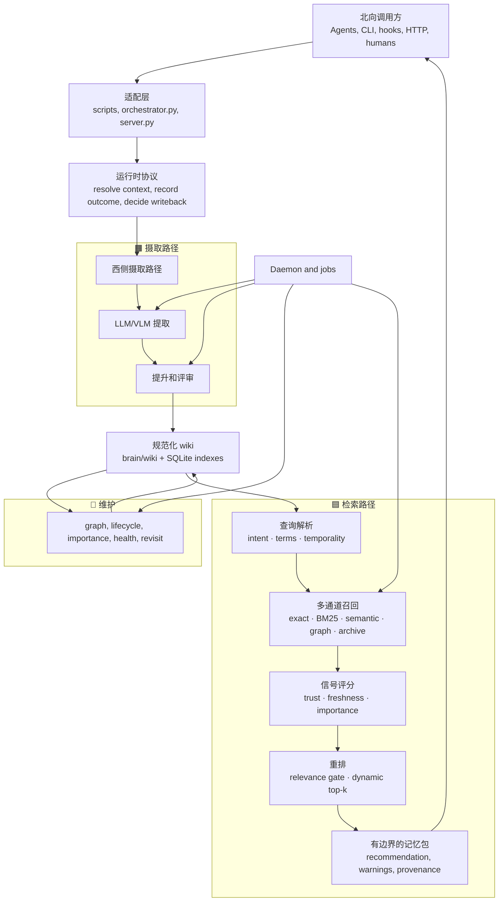
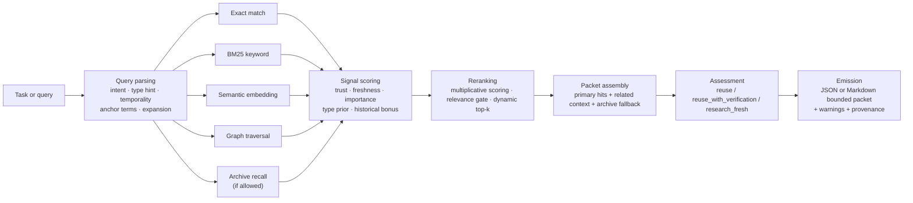
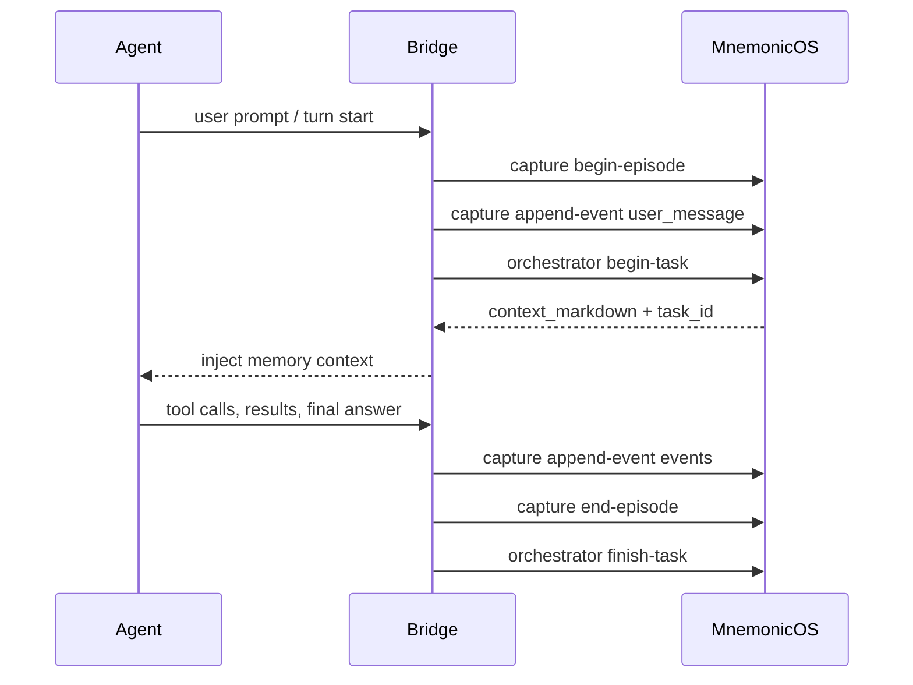

# MnemonicOS

[English version](README.md)

MnemonicOS 是一个自洽的记忆系统，用一条完整的服务链路捕获和保存原始记忆材料、精炼并治理规范化记忆，并提供记忆查询服务。



MnemonicOS 为 agent 提供一个持久的记忆底座。这个底座不依赖某一个模型、IDE、shell 或厂商。它捕获原始工作材料，把有用材料转化为受治理的笔记，保持这些笔记健康，并通过 CLI、hook 和 HTTP 向 agent 与人类返回有边界的上下文。

MnemonicOS 不是 agent。它是 agent 底层的记忆契约。

## 用途

- 保存来自 agent 会话、文件和工具活动的真实原始材料。
- 将原始材料转化为经过验证、绑定来源的记忆。
- 通过图谱、生命周期、重要性、评审和重访任务，让规范化记忆保持有用。
- 在工作前、失败后和写回决策期间，为 agent 提供上下文包。
- 让不同 agent 共享同一个本地记忆库，而不要求它们共享同一个运行时。

范围规则见 [Product Boundary](brain/system/product-boundary.md)，治理架构索引见 [Architecture](brain/system/architecture.md)。

## 架构



核心模块：

| 层 | 主要文件 | 作用 |
|---|---|---|
| 运行时和适配器 | `runtime.py`, `orchestrator.py`, `server.py`, `scripts/` | 面向 agent 的协议、hook 脚本、HTTP 传输。 |
| 原始摄取 | `ingest.py`, `session_capture.py`, `connectors/` | 将会话和文件捕获为不可变的真实原始材料。 |
| 投影 | `projection/` | 从原始材料构建临时文本窗口和 artifact 视图。 |
| 提取 | `extraction/` | 运行 VLM/LLM 推理，验证候选记忆 JSON。 |
| 提升 | `promotion/` | 门控、决策、渲染、写入，或路由到评审项。 |
| 维护 | `maintenance.py`, `jobs.py`, `daemon.py` | 让 wiki 保持链接、评分、评审和新鲜。 |
| 检索 | `retrieval.py`, `query_parser.py`, `recall.py`, `reranker.py`, `emission.py` | 只读上下文组装和包发射。 |

治理设计文档：

- [Ingestion Path Governance](brain/system/INGESTION-PATH-GOVERNANCE-DESIGN.md)
- [Retrieval Path Governance](brain/system/RETRIEVAL-PATH-GOVERNANCE-DESIGN.md)
- [Runtime Protocol](brain/system/runtime-protocol.md)
- [Bridge Capture Plan](brain/system/ingestion-capture-plan.md)
- [West Flange Plan](brain/system/ingestion-west-flange-plan.md)
- [Extraction Plan](brain/system/ingestion-extraction-plan.md)
- [Promotion Plan](brain/system/ingestion-promotion-plan.md)
- [Maintenance Plan](brain/system/ingestion-maintenance-plan.md)
- [Retrieval Roadmap](brain/system/retrieval-development-roadmap.md)

## 摄取流程

摄取是 MnemonicOS 的西侧路径。它接收原始材料，保存这些材料，只做临时投影，并让确定性的门控决定什么能成为规范化记忆。

```mermaid
flowchart LR
    A["Agent episode<br/>file, doc, PDF, HTML, session"] --> B["Capture or ingest"]
    B --> C["Immutable true raw<br/>brain/raw"]
    C --> D["RAM-only projection<br/>TextWindow + ArtifactView"]
    D --> E["VLM snippets<br/>optional visual pass"]
    D --> F["LLM candidate bundle"]
    E --> G["Validation<br/>schema + provenance"]
    F --> G
    G --> H["promotion_ready candidates"]
    H --> I["Promotion<br/>new, confirm, update, review, reject"]
    I --> J["brain/wiki"]
    I --> K["brain/wiki/review"]
    K --> AR["Auto-resolve daemon<br/>wiki_auto_resolve_review"]
    AR --> R["Human review fallback<br/>mnemonic review"]
    J --> L["Maintenance jobs"]
```



重要不变量：

- `brain/raw/*` 是见证材料。它会被保存，不会被重写。
- 投影是临时的。它创建可用的文本和 artifact 视图，但不会让模型解释成为权威。
- LLM/VLM 输出止步于已验证候选。它不会直接写入 wiki。
- 提升由软件门控，并写入 ledger。
- 模糊或冲突的材料会先由 auto-resolve daemon 处理（LLM 仲裁）；无法高置信解决的项目会进入人工评审，并附带 LLM 分析。

## 维护流程

维护是 MnemonicOS 的中心路径。它读取已提升的 wiki 笔记，保持规范化记忆图谱健康，派生长期信号，并在记忆开始漂移时排入评审或重访工作。


重要不变量：

- 维护作用于完整 wiki，而不是单个提取候选。
- 维护任务可以更新 wiki 元数据、图边、信号表、评审项、健康报告和重访队列。
- 维护永不重写真实原始材料，也永不修改历史提取或提升 ledger 行。
- 图重建、生命周期审计和重要性评分是确定性的，可以安全重跑。
- 语义去重和冲突检测会路由到评审；它们不会自动合并规范化笔记。
- 原始材料重访会创建带 lineage 元数据的新提取队列行，保留原始提取历史。

## 检索流程

检索是 MnemonicOS 的东侧路径。它读取已维护的记忆，并向调用方发射有边界的包。



重要不变量：

- 检索对记忆内容是只读的。它可以写入遥测和反馈信号，但不会修改规范化笔记。
- 召回策略跨所有通道运行；分数会在重排前合并。
- Archive recall 受门控，只有在 wiki 召回不足时才会浮现。
- 发射包里的 recommendation 对调用方协议有约束力。

## 安装

```bash
./scripts/install_mnemonicos.sh
cp config/memory.example.toml config/memory.toml
mnemonicos init-db
```

已安装命令：

- `mnemonicos`
- `mnemonicos-daemon`
- `mnemonicos-game`

示例配置默认使用确定性的 fixture/hash provider，因此系统无需外部模型服务也能运行测试和基础本地工作流。

## 关键 CLI 命令

```bash
# database and sync
mnemonicos init-db
mnemonicos sync --mode full

# daemon
mnemonicos daemon start
mnemonicos daemon status
mnemonicos daemon status --json
mnemonicos daemon watch --interval 3
mnemonicos daemon run-job process_extraction_queue
mnemonicos daemon stop
mnemonicos run-job wiki_health_report --dry-run

# raw artifact ingestion
mnemonicos ingest-artifact --file ./docs/paper.pdf --tag research --json
mnemonicos reprocess-artifact --failed --json
mnemonicos ingest-dir ./docs --recursive --json
mnemonicos migrate-raws ./brain/raw --dry-run --json

# bridge capture
mnemonicos capture begin-episode --bridge-id codex --conversation-id thread-001 --episode-id turn-001 --json
mnemonicos capture append-event --bridge-id codex --conversation-id thread-001 --episode-id turn-001 --type user_message --content "raw prompt" --json
mnemonicos capture end-episode --bridge-id codex --conversation-id thread-001 --episode-id turn-001 --status success --json

# agent runtime facade
mnemonicos orchestrator begin-task "debug the failing deploy" --bridge-id codex --json
mnemonicos orchestrator mark-failure "pytest failed in retrieval tests" --bridge-id codex --session-id s1 --task-id t1 --json
mnemonicos orchestrator finish-task --bridge-id codex --session-id s1 --task-id t1 --status success --outcome-type coding --summary "Fixed retrieval tests." --json

# queues, review, retrieval
mnemonicos queue-extraction --source-kind artifact --archive-id artifact/example --json
mnemonicos extraction-status
mnemonicos extraction-status --errors-only --json
mnemonicos retry-extraction --all-errors --dry-run
mnemonicos promote-status
mnemonicos review list
mnemonicos retrieve "what do we know about raw re-visitation?" --json
mnemonicos retrieve "what do we know about raw re-visitation?" --include-body --body-chars 4000 --json

# HTTP
mnemonicos server --host 127.0.0.1 --port 8000
```

常用任务名称：

```text
process_extraction_queue
process_promotion_queue
wiki_auto_resolve_review
expire_stale_episodes
embed_backfill
sync_vault_incremental
wiki_embedding_neighbor_backfill
wiki_cluster_validation
wiki_pattern_discovery
wiki_graph_rebuild
wiki_lifecycle_audit
wiki_importance_scoring
rerank_training
wiki_health_report
wiki_raw_revisitation
wiki_derive_passive_feedback
retry_failed_extractions
status_report
```

## Agent 适配

Agent 应使用 orchestrator facade 和 capture API，而不是自行发明记忆策略。



从这里开始：

- [Claude Code Bridge](docs/claude-code-bridge.md)
- [Codex Bridge From Scratch](docs/codex-bridge-from-scratch.md)
- [Claude bridge system note](brain/system/claude-bridge.md)
- [Codex bridge system note](brain/system/codex-bridge.md)

最小适配器契约：

1. 使用稳定的 `bridge_id`。
2. 在 turn 开始时 begin episode。
3. 追加原始事件，不重写先前事件。
4. 在模型需要记忆前调用 `orchestrator begin-task`。
5. 在第一次有意义失败后调用 `orchestrator mark-failure`。
6. 在完成时 end episode 并调用 `orchestrator finish-task`。

## 推理引擎适配

MnemonicOS 将模型传输和记忆策略分离。Provider 在 `config/memory.toml` 中配置；系统其他部分仍使用相同的提取、验证、提升和检索契约。

Provider 角色：

- `models.llm`：从文本窗口和视觉片段中提取候选。
- `models.vlm`：为图示和图片密集型文档做视觉描述。
- `embeddings`：语义检索和维护邻居扫描。

默认确定性开发配置：

```toml
[embeddings]
enabled = true
provider = "hash"
model = "hash-256-v1"
dimensions = 256

[models.llm]
provider = "fixture"
model = "fixture-llm"

[models.vlm]
provider = "fixture"
model = "fixture-vlm"
```

### Ollama 示例

Ollama 暴露本地 HTTP API，通常位于 `http://127.0.0.1:11434`，并为生成/聊天和 embeddings 提供独立 API。MnemonicOS 包含 Ollama provider 适配器。

```bash
ollama pull qwen2.5:7b
ollama pull llama3.2-vision:latest
ollama pull nomic-embed-text
```

```toml
[models.llm]
provider = "ollama"
model = "qwen2.5:7b"
base_url = "http://127.0.0.1:11434"
timeout_seconds = 180

[models.vlm]
provider = "ollama"
model = "llama3.2-vision:latest"
base_url = "http://127.0.0.1:11434"
timeout_seconds = 180

[embeddings]
enabled = true
provider = "ollama_embeddings"
model = "nomic-embed-text"
dimensions = 768
base_url = "http://127.0.0.1:11434"
timeout_seconds = 60
```

### vLLM 示例

vLLM 可以通过 OpenAI-compatible HTTP server 提供模型服务。MnemonicOS 对这种 endpoint 使用 `openai_compatible` 和 `openai_compatible_embeddings` provider。

```bash
vllm serve Qwen/Qwen2.5-7B-Instruct --host 127.0.0.1 --port 8001
```

```toml
[models.llm]
provider = "openai_compatible"
model = "Qwen/Qwen2.5-7B-Instruct"
base_url = "http://127.0.0.1:8001/v1"
api_key_env = ""
timeout_seconds = 180

[models.vlm]
provider = "openai_compatible"
model = "your-vision-model"
base_url = "http://127.0.0.1:8001/v1"
api_key_env = ""
timeout_seconds = 180

[embeddings]
enabled = true
provider = "openai_compatible_embeddings"
model = "your-embedding-model"
dimensions = 1536
base_url = "http://127.0.0.1:8001/v1"
api_key_env = ""
timeout_seconds = 60
```

当 endpoint 需要认证时，使用 `api_key_env = "OPENAI_API_KEY"` 或其他环境变量名。

## HTTP 协议

启动本地 server：

```bash
mnemonicos server --host 127.0.0.1 --port 8000
```

规范 schema：

- [api/openapi.yaml](api/openapi.yaml)

Endpoint 分组：

| Endpoint | 作用 |
|---|---|
| `GET /v1/health` | 健康状态和数据库就绪状态。 |
| `POST /v1/retrieve` | 直接检索查询。 |
| `POST /v1/orchestrator/begin-task` | Agent 预检上下文包。 |
| `POST /v1/orchestrator/mark-failure` | 记录失败并刷新上下文。 |
| `POST /v1/orchestrator/finish-task` | 记录结果并计算写回决策。 |
| `POST /v1/capture/begin-episode` | 打开原始捕获 episode。 |
| `POST /v1/capture/append-event` | 追加一个原始事件。 |
| `POST /v1/capture/end-episode` | 结束 episode 并排入下游处理。 |
| `POST /v1/ingest/session` | 归档 markdown/session 内容。 |
| `POST /v1/ingest/artifact` | 归档文件 artifact。 |
| `POST /v1/reprocess/artifact` | 重新运行 artifact 提取。 |
| `POST /v1/extraction/queue` | 手动排入提取。 |
| `POST /v1/extraction/process` | 处理待提取行。 |
| `GET /v1/extraction/status` | 查看提取队列状态。 |
| `POST /v1/promotion/process` | 处理 promotion-ready 候选。 |
| `GET /v1/promotion/status` | 查看提升队列状态。 |
| `POST /v1/sync/vault` | 将 markdown vault 同步到索引。 |
| `POST /v1/jobs/run` | 运行指定任务。 |

示例：

```bash
curl -s http://127.0.0.1:8000/v1/health

curl -s http://127.0.0.1:8000/v1/orchestrator/begin-task \
  -H 'Content-Type: application/json' \
  -d '{
    "bridge_id": "codex",
    "task_text": "debug the retrieval packet assembly",
    "session_id": "demo-session",
    "task_id": "demo-task"
  }'
```

## 仓库地图

```text
api/                       OpenAPI protocol
brain/system/              governing architecture and plans
brain/raw/                 true raw sessions and artifacts
brain/wiki/                canonical memory and review queue
config/memory.example.toml default local config
docs/                      bridge and audit guides
migrations/                SQLite schema migrations
scripts/                   hook scripts and helper commands
src/second_brain/          MnemonicOS runtime
tests/                     unit and integration tests
```

## 验证

```bash
python3 -m unittest discover -s tests
```

当前本地就绪检查：438 个测试通过。

## 外部推理参考

- [Ollama API documentation](https://docs.ollama.com/api)
- [Ollama embeddings documentation](https://docs.ollama.com/capabilities/embeddings)
- [vLLM OpenAI-compatible server documentation](https://docs.vllm.ai/en/stable/serving/openai_compatible_server.html)
