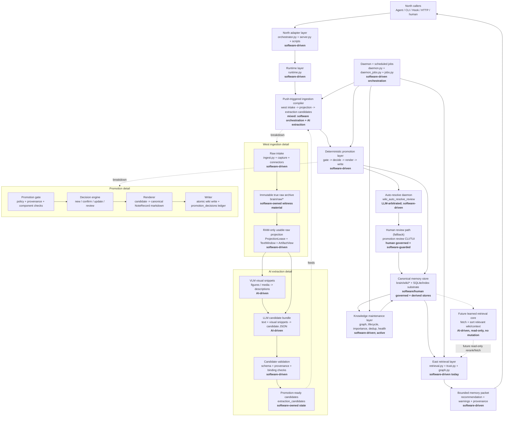

# MnemonicOS Architecture

This is the governing index for MnemonicOS architecture documentation.

## Authority Order

When documents conflict, use this order:

1. Current governing files under `brain/system/`.
2. Current runtime/API implementation and tests.
3. Strategic roadmaps under `development/`.
4. Historical or obsolete docs marked `OBSOLETE`.

The west-flange, LLM/VLM extraction, promotion, auto-resolve daemon, review command, and knowledge
maintenance governing plans are authoritative for their respective layers.

## Current System Shape

The storage/index substrate is currently SQLite plus markdown, FTS, vectors, and
graph/cache tables. Whether this should be treated as a full south flange or a
lower-level replaceable substrate remains an open architecture question.

The primary ingestion path is now push-triggered: artifact intake, archived
session intake, and episode close all enqueue extraction and trigger extraction
then promotion immediately. Scheduled daemon jobs are maintenance and recovery
surfaces, not the primary mechanism for discovering unprocessed true raw.

## Open Architecture Gaps

These are intentionally marked as guidance, not binding design. They identify
where the current system should evolve next without freezing implementation
details too early.

- **Knowledge maintenance layer is active.** All 9 wiki maintenance jobs
  (`wiki_importance_scoring`, `wiki_lifecycle_audit`, `wiki_graph_rebuild`,
  `wiki_embedding_neighbor_backfill`, `wiki_cluster_validation`,
  `wiki_pattern_discovery`, `wiki_raw_revisitation`, `wiki_derive_passive_feedback`,
  `wiki_health_report`) are implemented in `jobs.py` and scheduled in
  `daemon_jobs.py`. See [Knowledge Maintenance Layer Development Roadmap](ingestion-maintenance-roadmap.md)
  for phase completion status.
- **East retrieval pipeline (Stages 1–6) implemented; Stage 7 not started.** The
  7-stage pipeline is implemented across `query_parser.py` (Stage 1),
  `recall.py` (Stage 2), `signal_integration.py` (Stage 3), `reranker.py` (Stage 4),
  assembly in `runtime.py` (Stage 5), `assessor.py` (Stage 6). Stage 7 (Emission)
  phases remain not started — see [Retrieval Development Roadmap](retrieval-development-roadmap.md).
  The two Phase 0 audit bugs (`importance_score` dead code, `train_rerank_model()`
  unreachable) are fixed. The future DL north star (bi-encoder + cross-encoder)
  is deferred until ≥50 eval samples exist.
- **South boundary is unresolved.** SQLite, markdown, FTS, vectors, and graph
  tables are treated as replaceable substrate today. It is still undecided
  whether to formalize them as a south flange with explicit adapter contracts.
- **Review namespaces are shared but filtered.** Promotion review, maintenance
  verification review, merge review, and contradiction review can coexist under
  `brain/wiki/review/`. Promotion review commands must continue to filter by
  lifecycle/header contract so human promotion review does not consume unrelated
  maintenance items.
- **Verification depth trails architecture.** West-flange format fixtures,
  real-model LLM/VLM checks, promotion confirm/update end-to-end coverage, and
  maintenance-layer tests should expand as each layer becomes relied on in
  production use.
- **Learned components are advisory.** Any future learned daemon, learned
  retrieval core, or AI-assisted maintenance must preserve the current authority
  boundary: learned systems may suggest, rank, classify, or route, but canonical
  mutation remains software-gated and provenance-preserving.

## Governing References

### Ingestion Pipeline (West Flange + Extraction)

- [Product Boundary](product-boundary.md): product scope, flange vocabulary, and
  current boundary rules.
- [West-Flange Development Plan](ingestion-west-flange-plan.md): true raw,
  artifact identity, RAM projection, text windows, artifact views, and extraction
  handoff.
- [West-Flange Development Roadmap](ingestion-west-flange-roadmap.md): current
  west-flange implementation status and remaining verification gaps.
- [LLM/VLM Layer Development Plan](ingestion-extraction-plan.md): extraction
  queue, VLM snippets, LLM candidate bundles, deterministic validation, and the
  stop at `promotion_ready`.
- [LLM/VLM Layer Development Roadmap](ingestion-extraction-roadmap.md):
  current extraction-layer implementation status and remaining work.
- [Bridge Capture Development Plan](ingestion-capture-plan.md):
  north-flange raw session capture model.

### Promotion, Review, and Maintenance

- [Promotion Layer Development Plan](ingestion-promotion-plan.md):
  deterministic gate, decision, renderer, writer, daemon/admin surfaces, and
  promotion ledger.
- [Promotion Layer Development Roadmap](ingestion-promotion-roadmap.md):
  implementation status and remaining integration-test gaps.
- [Auto-Resolve Daemon Spec](../../docs/superpowers/specs/2026-05-18-auto-resolve-review-design.md):
  LLM-arbitrated resolution of review-routed candidates; enriches files for human when confidence < 0.75.
- [Review Command Development Plan](ingestion-review-plan.md): human
  approval/rejection path for review items the auto-resolve daemon could not resolve.
- [Review Command Development Roadmap](ingestion-review-roadmap.md):
  current review CLI/TUI status and hardening history.
- [Knowledge Maintenance Layer Development Plan](ingestion-maintenance-plan.md):
  planned full-wiki graph maintenance, lifecycle audit, importance scoring,
  semantic duplicate routing, and health reporting.
- [Knowledge Maintenance Layer Development Roadmap](ingestion-maintenance-roadmap.md):
  implementation status for the maintenance layer.
- [Retrieval Path Governance Design](RETRIEVAL-PATH-GOVERNANCE-DESIGN.md): master
  governance doc for the 7-stage retrieval pipeline, DL north star architecture,
  module responsibility matrix, and boundary rules.
- [Retrieval Development Roadmap](retrieval-development-roadmap.md): phase completion
  status for all 7 stages and DL north star.
- [East Flange Plan — Stage 1](retrieval-east-flange-plan.md): detailed per-phase plan
  for Query Parsing (ParsedQuery contract, classifier, temporality inference,
  anchor extraction, term expansion). "East flange" = Stage 1 specifically.
- [East Flange Roadmap — Stage 1](retrieval-east-flange-roadmap.md): phase status
  for the query parsing stage.

### Daemon Process Lifecycle

- [Daemon Process Lifecycle Plan](daemon-lifecycle-plan.md): governing design for
  `DaemonProcessRegistry`, extraction subprocess process-group ownership, the 7-step CLI
  stop escalation sequence, the `daemon_stopped` postcondition contract, and opt-in
  provider ownership (`ollama_managed`). Authoritative over `daemon.py`, `daemon_processes.py`,
  `cli.py` stop path, and `extraction/worker.py`.

### Runtime Protocol and Agent Bridges

- [Runtime Protocol](runtime-protocol.md): canonical protocol contract for
  `resolve_task_context`, `record_outcome`, `decide_writeback`, `run_maintenance`.
- [Claude Code Bridge](claude-bridge.md): hook wiring, task/session identity,
  writeback policy, enable/disable switch. Both phases implemented.
- [Codex Bridge](codex-bridge.md): current skill-based path and planned Phase 2
  adaptation layer (MCP, wrapper, breakpoint checkpointing).

### Retrieval and Quality

- [Control Signal Quality Roadmap](retrieval-control-signal-quality-roadmap.md): ACTIVE —
  gene strings, content quality gate, chain_id machinery. Spans Stages 3, 5, 6.
- [Episode-Aware Retrieval](episode-aware-retrieval.md): Phase 1 done (chain
  metadata on notes); Phases 2–6 deferred until evaluation data exists.
- [East Flange Audit](../../docs/east-flange-audit.md): Phase 0 audit — module-to-stage
  map, 2 critical bugs (importance dead code, training never triggered), extend verdict.
  **Both bugs subsequently fixed** (see retrieval-development-roadmap.md Phase 0 note).

### Interface and Positioning

- [Game Interface Skeleton](game-interface-skeleton.md): non-negotiable design
  decisions for the library RPG interface.
- [Competitive Positioning](competitive-positioning.md): positioning statement,
  differentiators, and market context.

### Vision and Roadmap

- [Humanoid MnemonicOS Core Blueprint](../../development/humanoid-MnemonicOS-core-blueprint.md):
  grand architectural vision — epistemic metabolism, provenance, abstraction
  distance, learned reasoning.
- [Learned Daemon Roadmap](../../development/learned-daemon-and-true-raw-memoryos-roadmap.md):
  Step 0 (MnemonicOS as MemoryOS), Step 1 (learned daemon), Step 2 (neuro-symbolic
  core).
- [Library RPG Roadmap](../../development/roadmap-library-rpg.md): detailed
  implementation plan for the game interface.

## South Boundary

The storage/index substrate (SQLite, vectors, graph) is currently treated as
replaceable substrate behind MnemonicOS. Whether to formalize this as a "south
flange" with explicit adapter contracts remains an open architecture question.
