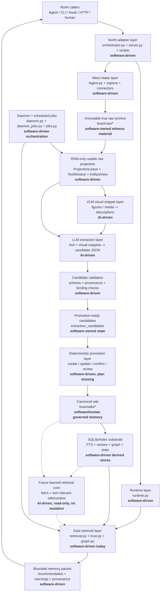

# MnemonicOS Architecture

This is the governing index for MnemonicOS architecture documentation.

## Authority Order

When documents conflict, use this order:

1. Current governing files under `brain/system/`.
2. Current runtime/API implementation and tests.
3. Strategic roadmaps under `development/`.
4. Historical or obsolete docs marked `OBSOLETE`.

The west-flange and LLM/VLM governing plans are already authoritative and should
not be rewritten as part of this cleanup.

## Current System Shape

The storage/index substrate is currently SQLite plus markdown, FTS, vectors, and
graph/cache tables. Whether this should be treated as a full south flange or a
lower-level replaceable substrate remains an open architecture question.

## Governing References

- [Product Boundary](product-boundary.md): product scope, flange vocabulary, and
  current boundary rules.
- [West-Flange Development Plan](west-flange-development-plan.md): true raw,
  artifact identity, RAM projection, text windows, artifact views, and extraction
  handoff.
- [West-Flange Development Roadmap](west-flange-development-roadmap.md): current
  west-flange implementation status and remaining verification gaps.
- [LLM/VLM Layer Development Plan](llm-vlm-layer-development-plan.md): extraction
  queue, VLM snippets, LLM candidate bundles, deterministic validation, and the
  stop at `promotion_ready`.
- [LLM/VLM Layer Development Roadmap](llm-vlm-layer-development-roadmap.md):
  current extraction-layer implementation status and remaining work.
- [Bridge Capture Development Plan](bridge-capture-development-plan.md):
  north-flange raw session capture model.

## Known Missing Governing Plans

These are intentionally not filled in by this cleanup:

- deterministic promotion layer plan;
- east-flange retrieval and future learned retrieval-core plan;
- library RPG interface skeleton;
- storage/substrate or south-boundary decision note.

## Obsolete Or Historical Planning Docs

The following docs are retained only for historical context and should not define
current implementation work:

- [Old docs boundary pointer](../../docs/boundary.md)
- [Old implementation plan](../../docs/IMPLEMENTATION_PLAN.md)
- [Old VLM/LLM extraction daemon plan](../../docs/vlm-llm-extraction-daemon-plan.md)
- [Old daemon deferred promotion roadmap](../../development/roadmap-daemon-deferred-promotion.md)
- [Old promotion detach transition plan](promotion-detach-plan.md)
