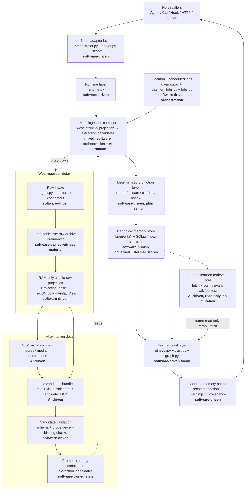

# MnemonicOS Architecture

This is the governing index for MnemonicOS architecture documentation.

## Authority Order

When documents conflict, use this order:

1. Current governing files under `brain/system/`.
2. Current runtime/API implementation and tests.
3. Strategic roadmaps under `development/`.
4. Historical or obsolete docs marked `OBSOLETE`.

The west-flange and LLM/VLM governing plans are already authoritative and should
not be rewritten as part of this cleanup.

## Current System Shape

The storage/index substrate is currently SQLite plus markdown, FTS, vectors, and
graph/cache tables. Whether this should be treated as a full south flange or a
lower-level replaceable substrate remains an open architecture question.

## Governing References

### Ingestion Pipeline (West Flange + Extraction)

- [Product Boundary](product-boundary.md): product scope, flange vocabulary, and
  current boundary rules.
- [West-Flange Development Plan](west-flange-development-plan.md): true raw,
  artifact identity, RAM projection, text windows, artifact views, and extraction
  handoff.
- [West-Flange Development Roadmap](west-flange-development-roadmap.md): current
  west-flange implementation status and remaining verification gaps.
- [LLM/VLM Layer Development Plan](llm-vlm-layer-development-plan.md): extraction
  queue, VLM snippets, LLM candidate bundles, deterministic validation, and the
  stop at `promotion_ready`.
- [LLM/VLM Layer Development Roadmap](llm-vlm-layer-development-roadmap.md):
  current extraction-layer implementation status and remaining work.
- [Bridge Capture Development Plan](bridge-capture-development-plan.md):
  north-flange raw session capture model.

### Next Layer (Stub Plans)

- [Promotion Layer Plan](promotion-layer-plan.md): stub for the deterministic
  promotion layer — consumes `promotion_ready` candidates and writes canonical
  wiki notes.
- [East Flange Plan](east-flange-plan.md): current retrieval state and stub for
  the future learned retrieval core.

### Runtime Protocol and Agent Bridges

- [Runtime Protocol](runtime-protocol.md): canonical protocol contract for
  `resolve_task_context`, `record_outcome`, `decide_writeback`, `run_maintenance`.
- [Claude Code Bridge](claude-bridge.md): hook wiring, task/session identity,
  writeback policy, enable/disable switch. Both phases implemented.
- [Codex Bridge](codex-bridge.md): current skill-based path and planned Phase 2
  adaptation layer (MCP, wrapper, breakpoint checkpointing).

### Retrieval and Quality

- [Control Signal Quality Roadmap](control-signal-quality-roadmap.md): ACTIVE —
  gene strings, content quality gate, chain_id machinery.
- [Episode-Aware Retrieval](episode-aware-retrieval.md): Phase 1 done (chain
  metadata on notes); Phases 2–6 deferred until evaluation data exists.

### Interface and Positioning

- [Game Interface Skeleton](game-interface-skeleton.md): non-negotiable design
  decisions for the library RPG interface.
- [Competitive Positioning](competitive-positioning.md): positioning statement,
  differentiators, and market context.

### Vision and Roadmap

- [Humanoid MnemonicOS Core Blueprint](../../development/humanoid-MnemonicOS-core-blueprint.md):
  grand architectural vision — epistemic metabolism, provenance, abstraction
  distance, learned reasoning.
- [Learned Daemon Roadmap](../../development/learned-daemon-and-true-raw-memoryos-roadmap.md):
  Step 0 (MnemonicOS as MemoryOS), Step 1 (learned daemon), Step 2 (neuro-symbolic
  core).
- [Library RPG Roadmap](../../development/roadmap-library-rpg.md): detailed
  implementation plan for the game interface.

## South Boundary

The storage/index substrate (SQLite, vectors, graph) is currently treated as
replaceable substrate behind MnemonicOS. Whether to formalize this as a "south
flange" with explicit adapter contracts remains an open architecture question.
