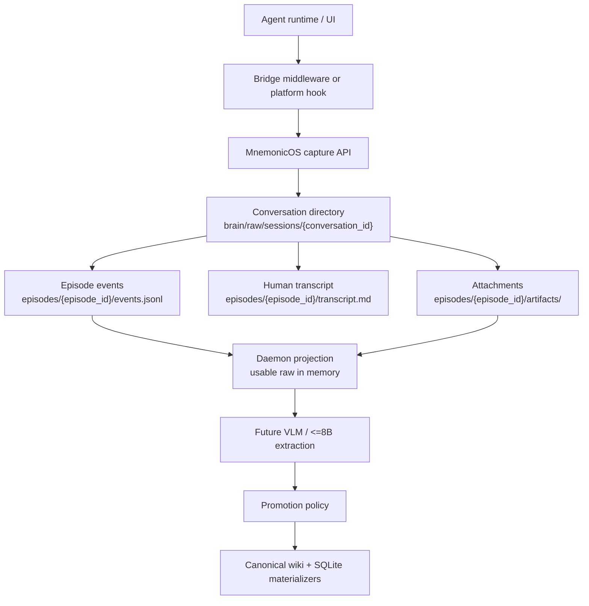
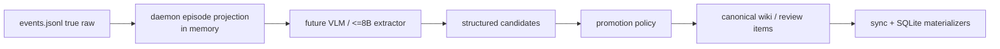

# Ingestion: Capture Plan

## Summary

MnemonicOS bridges should stop relying on LLM-discretionary skill calls for raw
session capture. Retrieval and writeback can remain agent-invoked, but raw
capture must be software-enforced by bridge middleware, platform hooks, or local
wrappers.

The bridge should observe completed turns and tool activity, then append raw
events to MnemonicOS. MnemonicOS owns the file layout, append semantics,
manifests, attachment storage, and later extraction pipeline.

---

## Core Model

The archival primitive is not a "complete session". Agentic conversations can be
reopened days later, continued from old threads, branched into subagents, or
started fresh while referring to old work.

Use three identities:

- `conversation_id`: durable thread identity across reopened chats.
- `episode_id`: one active visit/run/span within a conversation.
- `task_id`: user-visible work unit; optional and may span many events.

Suggested raw layout:

```text
brain/raw/sessions/{conversation_id}/
    manifest.json
    episodes/
        {episode_id}/
            events.jsonl
            transcript.md
            artifacts/
```

`events.jsonl` is the spine. Attachments store large outputs, diffs, generated
files, command logs, search snapshots, or child branch logs.



---

## Reliability Principle

Raw capture must not depend on the LLM deciding to call a skill or tool.

Preferred enforcement layers, strongest last:

1. Voluntary LLM/tool call: acceptable for retrieval and explicit writeback, not
   acceptable for guaranteed raw capture.
2. Agent wrapper or bridge middleware: intercepts turns/tool activity and calls
   MnemonicOS automatically.
3. Platform-native lifecycle hooks: best case; hook adapter forwards observed
   events to MnemonicOS.

Minimum reliable capture:

- user message after submission
- assistant final output after completion
- tool call and tool result
- observable file edits/diffs as attachments
- errors, retries, and failures
- episode start/end metadata

Token-level streaming capture is not required for v1. Per-turn and per-tool
append is enough.

---

## Bridge API

Add bridge-facing capture operations.

### `begin_episode`

Purpose:

- Create or open a durable conversation directory.
- Create a new episode directory.
- Initialize `manifest.json`, `events.jsonl`, `transcript.md`, and `artifacts/`.

Inputs:

- `bridge_id`
- optional `conversation_id`
- optional `episode_id`
- optional `parent_conversation_id`
- optional `related_conversation_ids`
- metadata such as cwd, repo, branch, model, agent runtime, UI thread id

Output:

- `conversation_id`
- `episode_id`
- paths for event log, transcript, and artifact directory

### `append_event`

Purpose:

- Append one complete event record to `events.jsonl`.
- Store oversized payloads in `artifacts/` and replace inline content with a
  pointer.
- Update `transcript.md` for user/assistant message events.

Event envelope:

```json
{
  "seq": 1,
  "ts": "2026-04-27T16:30:00+08:00",
  "conversation_id": "codex-thread-abc",
  "episode_id": "2026-04-27T163000+0800",
  "bridge_id": "codex",
  "task_id": "optional-task-id",
  "branch_id": "main",
  "type": "user_message",
  "payload": {}
}
```

Common event types:

- `episode_started`
- `user_message`
- `assistant_message`
- `tool_call`
- `tool_result`
- `file_changed`
- `artifact_created`
- `retrieval_packet`
- `failure`
- `branch_started`
- `branch_completed`
- `episode_ended`

### Event Payload Schemas

Minimum required fields per event type. All payloads may carry additional
bridge-specific fields — extraction must tolerate unknown fields.

```jsonc
// user_message
{ "content": "..." }

// assistant_message
{ "content": "...", "stop_reason": "end_turn|tool_use|max_tokens" }

// tool_call
{ "call_id": "...", "tool_name": "...", "input": {} }

// tool_result
{ "call_id": "...", "tool_name": "...", "output": "...", "is_error": false }

// file_changed
{ "path": "relative/path", "change_type": "created|modified|deleted",
  "artifact": "artifacts/patch-001.diff" }   // diff stored as attachment

// artifact_created
{ "artifact": "artifacts/filename", "mime_type": "...", "byte_size": 0 }

// retrieval_packet
{ "query": "...", "result_count": 0, "artifact": "artifacts/retrieval-001.json" }

// failure
{ "message": "...", "error_type": "...", "recoverable": true,
  "tool_call_id": "optional" }

// branch_started
{ "branch_id": "...", "parent_seq": 0,
  "artifact": "artifacts/{branch_id}/events.jsonl" }

// branch_completed
{ "branch_id": "...", "status": "success|failure|partial",
  "artifact": "artifacts/{branch_id}/events.jsonl" }

// episode_started / episode_ended  (see begin_episode / end_episode inputs)
```

### Large Payload Rule

- Keep the JSONL line compact and replayable.
- Store large command output, search results, diffs, generated files, screenshots,
  and branch logs under `artifacts/`.
- Put attachment pointers in the event payload.
- Default threshold: **32 KB** inline; anything larger goes to `artifacts/`.
  Configurable via `MNEMOS_ARTIFACT_THRESHOLD_BYTES`.

### `end_episode`

Purpose:

- Append `episode_ended`.
- Flush final metadata.
- Record event count, content hashes, status, and end timestamp.

Inputs:

- `conversation_id`
- `episode_id`
- status: `success`, `failure`, `partial`, `abandoned`
- optional final metadata

---

## Branching And Multi-Agent Work

Use `branch_id` on events for lightweight branching.

For substantial subagent work, write a child event log and reference it:

```json
{
  "type": "branch_started",
  "branch_id": "agent-a",
  "parent_seq": 21,
  "artifact": "artifacts/agent-a/events.jsonl"
}
```

This keeps the parent episode readable while preserving child traces in full.

---

## Conversation Continuation

Reopening an old chat should create a new episode under the same
`conversation_id`, not mutate the old episode.

Fresh chats that refer to old chats should stay separate conversations with soft
links:

```json
{
  "type": "conversation_reference",
  "target_conversation_id": "old-chat-id",
  "confidence": "user_mentioned"
}
```

MnemonicOS can later strengthen or reject these links during extraction and
promotion.

---

## Conversation ID Derivation

Platform hooks don't always expose a clean conversation identifier. Each bridge
adapter must derive or generate `conversation_id` deterministically.

| Platform | Strategy |
|---|---|
| Claude Code (hooks) | Derive from `CLAUDE_SESSION_ID` env var if available; else hash of `cwd + session_start_ts` persisted in MnemonicOS bridge state |
| Codex / OpenAI agents | Use thread ID from platform API |
| Generic / unknown | UUID generated at first `begin_episode` call and persisted in MnemonicOS bridge state |

Do not write bridge state into arbitrary repo roots by default. The default
state location should live inside the MnemonicOS vault:

```text
brain/raw/sessions/.bridge_state/{bridge_id}/{cwd_hash}.json
```

The state file records the current `conversation_id`, cwd hash, creation time,
last-seen timestamp, and any platform thread id. It survives hook restarts
within the same working session. Bridge adapters delete or rotate it when they
detect a new logical conversation (new cwd, explicit session reset,
user-triggered fresh start, or changed platform thread id).

Writing `.mnemos-conv-id` into cwd is allowed only as an explicit opt-in for
simple local wrappers.

---

## Atomic Write and Crash Safety

`events.jsonl` is the raw archive spine. Corruption on crash is unacceptable.

Required write procedure for `append_event`:

1. Serialize the event to a complete JSON line (no embedded newlines).
2. Acquire an episode-local append lock such as `events.lock`.
3. Re-read the latest sequence counter while holding the lock.
4. Write to a unique temp file in the same directory, such as
   `events.jsonl.{pid}.{seq}.tmp`.
5. `fsync` the temp file.
6. Append temp content to `events.jsonl` using append mode.
7. `fsync` `events.jsonl`.
8. Delete temp file.
9. Release the append lock.

Do not use a fixed temp name such as `events.jsonl.tmp`; concurrent hooks can
race and overwrite it.

`transcript.md` is human-readable only — eventual-consistency update is
acceptable; crash leaving it stale is not a data loss event.

Manifest counters are updated after a successful append. A manifest counter
mismatch after crash can be repaired by replaying `events.jsonl`.

---

## Manifest Layout

Two manifest levels.

**Conversation-level** `brain/raw/sessions/{conversation_id}/manifest.json`:

```json
{
  "conversation_id": "...",
  "bridge_id": "...",
  "created_at": "...",
  "last_active_at": "...",
  "episode_count": 0,
  "episode_ids": [],
  "related_conversation_ids": [],
  "parent_conversation_id": null
}
```

**Episode-level** `brain/raw/sessions/{conversation_id}/episodes/{episode_id}/manifest.json`:

```json
{
  "conversation_id": "...",
  "episode_id": "...",
  "bridge_id": "...",
  "task_id": null,
  "status": "active|success|failure|partial|abandoned",
  "started_at": "...",
  "ended_at": null,
  "event_count": 0,
  "artifact_count": 0,
  "content_hash": null,
  "cwd": "...",
  "repo": null,
  "branch": null,
  "model": null,
  "agent_runtime": null
}
```

Conversation manifest is updated by `begin_episode` and `end_episode`.
Episode manifest is updated by `begin_episode`, each `append_event` (counters),
and `end_episode`.

---

## Context Compression Blind Spot

Claude Code compresses conversation context mid-session when approaching context
limits. After compression fires, hooks observe the compressed/summarized turn,
not the original tokens.

This is a known gap for comprehensive capture. Mitigations:

- `UserPromptSubmit` and `Stop` hooks fire per-turn before/after compression
  decisions; capture what is observable at hook time.
- If Claude Code exposes a pre-compression transcript field in hook context,
  prefer that.
- Mark episodes where compression was detected with
  `"context_compressed": true` in episode manifest so the extraction daemon
  can treat the episode as partial.

Full pre-compression capture is not possible through hooks in v1. Accept the
limitation; do not block v1 on it.

---

## Integration with Projection and Promotion

Captured episode logs are true raw. They must not be re-archived as synthetic
session markdown just to feed the existing promotion path.

Add a daemon-side episode projection path:

1. Read episode `events.jsonl`.
2. Generate usable raw in memory from `user_message`, `assistant_message`,
   `tool_call`, `tool_result`, `retrieval_packet`, and failure events.
3. Read large payload attachments only when needed for projection.
4. Feed usable raw to the future VLM / <=8B extraction path.
5. Persist structured candidates and promotion/review decisions, not the usable
   raw projection.

For an interim bridge to the current promotion machinery, add
`project_episode_for_promotion(conversation_id, episode_id)` (obsolete legacy promotion path):

- builds session-like markdown in memory from the event stream
- calls candidate extraction/promotion helpers directly
- records provenance back to `conversation_id`, `episode_id`, and event ranges
- does **not** call `_archive_session()`
- does **not** create a duplicate raw archive
- does **not** create artifact/archive chunks from the projected text

Schema note:

- Do not set `archive.type = "episode"` unless a migration explicitly adds that
  enum value.
- Prefer a dedicated episode index table such as `raw_episodes`, or store
  episode metadata in the conversation/episode manifests until the daemon-side
  projection schema is finalized.



---

## Legacy Deprecation Criteria

`ingest-session` summary flow (discretionary LLM writeback) is kept for
backward compatibility until:

1. At least one bridge adapter ships and passes the full test plan.
2. The daemon-side episode projection path is verified end-to-end.
3. All active bridges have migrated or have a migration date committed.

After those criteria are met, mark `ingest-session` as deprecated in the CLI
help text. Remove after one release cycle.

---

## Implementation Shape

Add `src/second_brain/session_capture.py`:

- normalize ids and paths
- create conversation/episode directories
- append JSONL with monotonic `seq`
- lock, append, and fsync after each event
- write attachments for large payloads
- update human-readable transcript
- update manifest counters and hashes

Add models:

- `BeginEpisodeRequest`
- `BeginEpisodeResult`
- `AppendEventRequest`
- `AppendEventResult`
- `EndEpisodeRequest`
- `EndEpisodeResult`

Add CLI:

```bash
mnemonicos capture begin-episode ...
mnemonicos capture append-event ...
mnemonicos capture end-episode ...
```

Add HTTP:

```text
POST /v1/capture/begin-episode
POST /v1/capture/append-event
POST /v1/capture/end-episode
```

Keep the current `ingest-session` summary flow temporarily as legacy
compatibility. New bridges should prefer comprehensive capture APIs.

---

## Test Plan

- Begin episode creates the expected directory tree.
- Begin episode initializes conversation and episode manifests.
- Append user/assistant messages writes JSONL and updates `transcript.md`.
- Append tool call/result writes JSONL.
- Large payloads become artifact files with event pointers.
- Sequence numbers are monotonic across appends.
- Reopening a conversation creates a new episode without changing old episode
  logs.
- Branch events can carry `branch_id` and/or point to child logs.
- End episode records status, end time, event count, and hashes.
- Legacy `ingest-session` continues to work unchanged.

---

## Assumptions

- Agent runtimes can expose events through hooks, wrappers, middleware, or local
  adapters.
- MnemonicOS should own raw capture layout and append semantics.
- Bridge adapters should forward observed events, not interpret them.
- Extraction into structured wiki candidates happens later over captured raw
  episodes.
