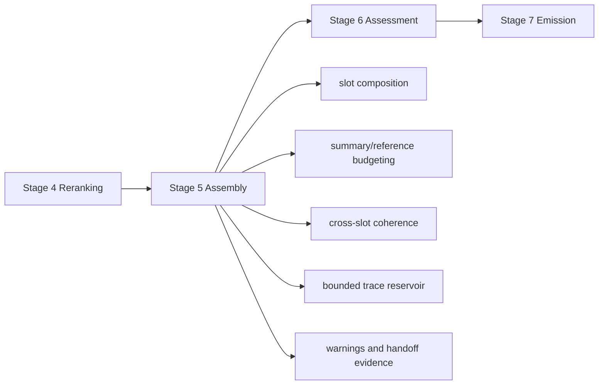

# Retrieval Assembly Plan — Stage 5

## Purpose

Stage 5 consumes `RankedHits` from Stage 4 and builds the coherent memory packet
that a caller can actually read. It is the readout layer: ranked entries become
an assembled note-like context with primary facts, episode context, related
material, raw archive evidence, warnings, and provenance.

Stage 5 answers: **what should be placed in front of the query party, and how
should the pieces be arranged so Stage 6 can assess sufficiency and decide
adjustments?** It does not decide final sufficiency, recommendation, or
fresh-research policy. Stage 6 owns those decisions.

This governing file defines scope, vocabulary, invariants, and phase order.
Implementation details live in the phase files:

1. [Phase 1: Packet Contract and Archive Slot](retrieval-assembly-plan-phase1.md)
2. [Phase 2: Primary Readout and Quality Routing](retrieval-assembly-plan-phase2.md)
3. [Phase 3: Same-Episode Context](retrieval-assembly-plan-phase3.md)
4. [Phase 4: Related Context Slots and Bounded Trace Completion](retrieval-assembly-plan-phase4.md)
5. [Phase 5: Deduplication and Slot Coherence](retrieval-assembly-plan-phase5.md)
6. [Phase 6: Context Budget and Body Trimming](retrieval-assembly-plan-phase6.md)
7. [Phase 7: Contradictions and Assessment Handoff](retrieval-assembly-plan-phase7.md)

---

## Boundary



```text
RankedHits
  -> slot selection
  -> bounded trace completion
  -> functional path reconstruction
  -> summary/reference budgeting
  -> dedupe / coherence pass
  -> RawPacket
```

Stage 5 owns:

- converting ranked hits into packet slots
- keeping wiki and archive evidence structurally separated
- deciding which ranked hits become primary, contextual, or warning-only
- reconstructing functional order across selected entries: goal, failures,
  diagnoses, decisions, successful resolution, current reusable path, and
  cautions
- completing incomplete functional paths through a bounded, deterministic trace
  over explicit maintenance relations
- carrying an in-memory assessment reservoir that Stage 6 can select from
  without rerunning recall
- carrying enough summaries, excerpts, paths, and provenance for a coherent
  pre-assessment readout
- cross-slot deduplication and stable ordering
- context budget enforcement
- contradiction and coherence annotations for Stage 6

Stage 5 does not own:

- recall channels or candidate generation (Stage 2)
- trust/freshness/quality signal derivation (Stage 3)
- final ranking scores (Stage 4)
- sufficiency state and recommendation (Stage 6)
- Markdown/JSON rendering protocol (Stage 7)

---

## Packet Vocabulary

Planned contract name: `RawPacket` or an evolved `MemoryPacket`. The name should
be settled in Phase 1 before implementation.

| Slot | Contents |
|------|----------|
| `primary_memories` | Top canonical wiki notes selected for direct reuse. |
| `same_episode_context` | Notes sharing `chain_id` or session lineage with the lead primary notes. |
| `related_by_topic` | Graph-adjacent or tag/entity-related notes that add topical context. |
| `related_by_timeline` | Before/after/supersedes-related notes and relevant incidents. |
| `related_by_similarity` | Semantic neighbors that are useful but not primary. |
| `related_by_contrast` | `contrasts_with` notes that help distinguish alternatives. |
| `archive_context` | Raw archive fallback chunks, always labeled as raw-session/source evidence. |
| `contradictions` | Supersession, contested, or conflict pairs among assembled items. |
| `warnings` | Stale, suspect, contested, quality-failed, archive-only, or budget-trimmed notices. |
| `assembly_notes` | Machine-readable handoff facts for Stage 6 adjustment logic. |
| `functional_path` | Ordered reconstruction of attempts, failures, pivots, successes, and current reusable conclusions when relation evidence supports it. |
| `assessment_reservoir` | Bounded in-memory set of assembled and trace-completed branches from which Stage 6 may choose an emission subset. |

`assembly_notes` should be structured rather than prose-heavy. It is the
leverage surface for Stage 6: budget pressure, archive-only status, missing
primary memory, warning-only candidates, contradiction severity, and
body-reference details.

`functional_path` is the main guardrail against score-order confusion. Stage 4
rank order is evidence priority: it decides which entries are worth assembling.
Stage 5 assembly order is explanatory priority: it arranges selected entries so
the remembered path of work is faithful. A high-ranked successful procedure may
be the reusable conclusion, while lower-ranked incidents and failed attempts may
need to appear earlier in the reconstructed path so the success is not detached
from the mistakes and pivots that produced it.

`assessment_reservoir` is not emitted wholesale. It is a bounded temporary
memory for the current retrieval call. It lets Stage 5 preserve the whole
trace-completed assembly while Stage 6 decides whether the first response should
show a concise success path, success plus major failures, the full chain, or
only warnings. Reservoir entries use the same item contract as normal slots plus
branch metadata: `branch_id`, `functional_role`, `trace_source`, `trace_depth`,
`edge_path`, `is_deferred_by_default`, and `defer_reason`.

---

## Bounded Trace Completion

Trace completion exists to avoid the common failure mode where Stage 2 direct
hits plus one graph layer retrieve only a few links in a larger process chain.
It is still Stage 5 assembly work, not new recall. It starts only from notes
already admitted into the packet or explicitly related to those notes by
maintenance edges.

This pass is deliberately not placed in Stage 2, even though Stage 2 owns broad
recall and graph tracing. Stage 2 asks "what candidates might be relevant?"
Stage 5 asks "given the selected candidates and the caller's purpose, which
missing links are required to make this assembled path coherent?" That
distinction keeps trace completion purpose-aware and prevents the packet from
becoming every note that happens to be linked.

Purpose-awareness is deterministic. Stage 5 must not call an LLM to decide
whether a trace endpoint is useful. It derives a small `TracePurpose` from
typed upstream signals: `ParsedQuery.query_type`, temporality, caller/task kind,
query anchors, top primary note type, current functional-path gaps, and packet
warnings/contradictions. The trace pass then applies a fixed admission test to
each linked endpoint.

```text
TracePurpose:
  intent: implementation|debugging|historical|comparison|factual
  required_roles: list[functional_role]
  optional_roles: list[functional_role]
  low_value_roles: list[functional_role]
  terminal_preference: success|diagnosis|timeline|contrast|none
```

A trace edge is necessary but not sufficient. The endpoint is admitted only if
the relation is allowlisted, the endpoint matches the active query/branch
anchors or is connected by a strong causal/supersession edge, and it fills a
required/optional role, resolves ordering ambiguity, chooses between current and
superseded paths, exposes a major warning, or connects already-admitted
fragments into one coherent branch.

### Trigger

Run the trace pass when any of these are true:

- a primary or same-episode item has `chain_id` but the assembled path lacks a
  terminal success, failure, or unresolved state
- the query intent is implementation/debug/procedure and the current packet has
  a success without prerequisites or a failure without diagnosis/resolution
- relation metadata mentions path-forming edges such as `failed_due_to`,
  `attempts_to_solve`, `supports_solution`, `derived_from`, `before`, `after`,
  or `supersedes`
- Stage 5 has enough candidates to suggest a chain but `functional_path` would
  otherwise be `partial` or `none`

Do not run the trace pass for flat factual/person/source lookups unless an
explicit relation edge indicates a process chain.

The trace pass must be constrained by caller intent. A debugging query may
repair a branch by adding failure, diagnosis, and successful resolution notes.
An implementation query may add prerequisites, decisions, and current procedure.
A historical query may add timeline neighbors. None of these intents justify
fetching all linked notes, all same-chain notes, or all graph-adjacent context.
Each added item must fill a missing functional role, clarify branch ordering,
or expose a safety warning that Stage 6 needs for assessment.

### Allowed Expansion

The pass may follow only explicit wiki maintenance relations:

- episode: `chain_id`, session lineage
- timeline: `before`, `after`
- replacement: `supersedes`, `superseded_by`
- causal/debug: `failed_due_to`, `attempts_to_solve`, `supports_solution`
- derivation: `derived_from`
- typed workflow links among incidents, decisions, concepts, and procedures

It must not call semantic search, BM25, archive search, embedding scans, or a
fresh Stage 2-4 ranking pass.

### Caps

Default caps should be conservative and configurable:

- max trace depth: 2 explicit edges from an admitted seed
- max added wiki items: 8
- max branches: 3
- max items per branch: 6
- max superseded/caution branches: 2
- archive items: 0 added by trace completion

When caps are hit, Stage 5 records `trace_budget_limited: true` and the omitted
edge families in `assembly_notes`; it does not silently drop that fact.

Caps are a last guardrail, not the primary filter. The primary filter is
purpose fit: if a linked note does not answer the current intent or fill a
missing role in the active branch, it is not admitted merely because a relation
exists.

### Branch and Role Model

Trace completion should group path items into branches rather than one flat
list. A branch represents one plausible remembered process:

```text
goal / question
-> failed attempts
-> diagnoses and constraints
-> decisions / pivots
-> successful resolution
-> current reusable procedure
-> cautions, superseded branches, unresolved follow-up
```

Functional roles are advisory labels for Stage 6 and Stage 7. They should be
derived first from explicit relation type and note type, then from chain order,
and only finally from weak title/summary heuristics. If role inference is weak,
record `functional_path_confidence = partial` or `inferred`.

### Ordering and Authority

Stage 4 score remains evidence priority. Trace order is explanatory priority.
The pass should never promote a low-authority traced item into primary memory
solely because it completes a branch. Traced items enter the reservoir and the
appropriate contextual slot, keep their original score if previously ranked,
and carry `trace_source`/`edge_path` if added only by trace completion.

### Reservoir Policy

All admitted primary, same-episode, related, warning, and traced items are
available to the reservoir. Stage 5 marks the default branch for first emission
using this preference order:

1. current verified procedure or canonical success path
2. aging but quality-passed success path with cautions
3. partial path with explicit unresolved state
4. raw archive evidence only, labeled non-canonical

Other branches are preserved as deferred reservoir branches. Stage 6 decides
whether to emit them now, defer them until first failure, or request a fresh
pipeline run.

---

## Non-Negotiable Invariants

- Archive chunks never appear in canonical wiki slots.
- Stage 5 must preserve low-trust or warning candidates as warnings when they
  matter; it must not silently erase them.
- Cross-slot deduplication is deterministic and earlier, higher-authority slots
  win.
- Stage 4 rank order must be preserved as score metadata, but must not be used
  as the sole readout order when timeline or causal evidence exists.
- Functional ordering must prefer explicit maintenance relations over inferred
  ordering. Useful relations include `chain_id`, `before`, `after`,
  `supersedes`, `failed_due_to`, `attempts_to_solve`, `supports_solution`,
  `derived_from`, and incident/decision/procedure links.
- Trace completion is bounded and deterministic. It never performs semantic,
  lexical, archive, or broad graph recall; it only follows explicit relations
  from admitted seeds.
- The assessment reservoir is temporary packet state. It is not persisted as a
  new note and is not emitted wholesale unless Stage 6 explicitly requests a
  full-chain profile.
- Title, type, ID, summary, provenance, body reference, freshness, lifecycle,
  and relation metadata are never lost during packet budgeting.
- The assembled packet must be inspectable without DB access by Stage 6.
- Stage 6 must not need to repeat Stage 5 slot selection to classify
  sufficiency.

---

## Completion Gate

Stage 5 is complete when:

1. A typed packet contract exists and includes an explicit `archive_context`
   lane.
2. Primary memories are selected from ranked wiki hits with quality/freshness
   routing preserved for warnings.
3. Same-episode context is included without letting episode material dominate
   canonical readout.
4. Related slots are populated by relation family, similarity, and timeline
   semantics.
5. Bounded trace completion fills missing functional roles from explicit
   relation edges without rerunning recall.
6. Functional path reconstruction preserves success/failure order when
   maintenance links or timeline evidence support it.
7. The assessment reservoir preserves trace-completed branches for Stage 6
   without forcing Stage 7 to emit the whole history.
8. Cross-slot deduplication is deterministic and tested.
9. Context budget enforcement preserves metadata, summaries, excerpts, and body
   references while keeping full body hydration out of Stage 5.
10. Contradictions, warnings, and assembly notes give Stage 6 enough leverage to
   assess and adjust without DB access.

Current implementation satisfies the runtime packet path. Full body hydration,
truncation, and final caller-facing formatting belong to Stage 7 emission, not
Stage 5 assembly.

---

## Reference

**Roadmap:** [retrieval-assembly-roadmap.md](retrieval-assembly-roadmap.md)  
**Overall roadmap:** [retrieval-development-roadmap.md](retrieval-development-roadmap.md)  
**Governance:** [RETRIEVAL-PATH-GOVERNANCE-DESIGN.md](RETRIEVAL-PATH-GOVERNANCE-DESIGN.md)
