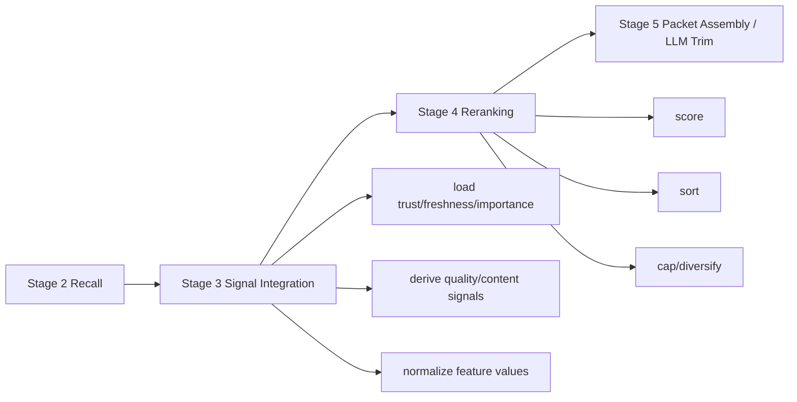

# Retrieval Reranking Plan — Stage 4

## Purpose

Stage 4 consumes `SignalEnrichedCandidatePool` from Stage 3 and produces ordered
`RankedHits` for Stage 5 assembly.

Stage 4 answers: **given the integrated signals, where should this candidate
rank?** It does not load maintenance tables, inspect full note bodies, classify
sufficiency, or interpret raw-session outcomes.

This governing file defines scope, vocabulary, invariants, and phase order.
Implementation details live in the phase files:

1. [Phase 1: RankedHits Contract and Lane Separation](retrieval-reranking-plan-phase1.md)
2. [Phase 2: Heuristic Scoring Formula](retrieval-reranking-plan-phase2.md)
3. [Phase 3: Exact and Archive Ranking Rules](retrieval-reranking-plan-phase3.md)
4. [Phase 4: Caps, Diversification, and Stability](retrieval-reranking-plan-phase4.md)
5. [Phase 5: Training Labels, Weights, and Feedback Integration](retrieval-reranking-plan-phase5.md)

---

## Boundary



```text
SignalEnrichedCandidatePool
  -> score candidates
  -> sort / cap / diversify
  -> RankedHits
```

Stage 4 owns:

- final candidate scoring
- exact-match bypass ranking
- separate archive ranking
- deterministic sort and tie-breaking
- ranked-hit and feature instrumentation payloads
- loading rerank weights
- training/weight update trigger integration

Stage 4 does not own:

- loading trust/freshness/importance tables (Stage 3)
- deciding content quality (Stage 3)
- hydrating full note bodies (Stage 5)
- assessment/recommendation (Stage 6)
- interpreting raw sessions into passive feedback (promotion/maintenance)

---

## Scoring Formula

Cold-start scoring uses the weighted formula:

```text
final_score = (
  bm25_weight          * normalize_bm25(rank, pool_max)
  + semantic_weight    * semantic_score
  + graph_weight       * normalize_graph(graph_score, pool_max)
  + type_prior_weight  * type_prior_score
  + freshness_weight   * freshness_score
  + trust_weight       * trust_score
  + importance_weight  * normalize_importance(importance_score, pool_max)
  + quality_weight     * quality_pass
  + exact_alias_weight * exact_bonus
  + historical_bonus
) * freshness_multiplier
```

Exact alias/title candidates bypass ordinary scoring:

```text
final_score = 1_000_000 - exact_rank
```

Archive candidates are ranked separately using archive-channel evidence and
never merged into the wiki primary lane.

---

## Feedback and Training Position

Reranking creates exposure evidence, not usefulness evidence.

| Label | When assigned | Owner | Strength |
|-------|---------------|-------|----------|
| `hit` | candidate enters ranked pool | Stage 4 instrumentation | weak exposure |
| `selected` | candidate emitted into packet/result | Stage 4/5 instrumentation | weak exposure |
| `explicit_used` | caller/outcome names useful ID | runtime outcome | strong positive |
| `explicit_misleading` | caller/outcome names misleading ID | runtime outcome | strong negative |
| `passive_used_likely` | promoted session evidence suggests use | maintenance | medium positive |
| `passive_useful_likely` | post-hoc evidence suggests the note helped | maintenance | medium positive |
| `passive_misleading_likely` | promoted evidence suggests harm/staleness | maintenance | medium negative |

Stage 4 local-linear training may consume both explicit and passive labels after
maintenance has materialized them, but label weights must reflect confidence.
Passive labels are not produced by the reranker itself. Runtime scoring reads
passive labels only through Stage 3 `NoteSignals`; the training job may consume
training datasets derived from `note_passive_feedback`. It must not read raw
sessions, extraction candidates, or `promotion_decisions.retrieval_attribution_json`.

---

## Non-Negotiable Invariants

- Stage 4 consumes Stage 3 output only; no direct maintenance-table reads.
- Stage 4 is deterministic for fixed inputs and weights.
- Exact wiki candidates rank above heuristic wiki candidates.
- Archive candidates remain in their own lane.
- Exposure logging must not imply usefulness.
- Learned reranking must be swappable behind the same `rerank()` API.
- `importance_score` must be included in the scoring/logging surface.
- Passive labels are confidence-weighted training labels, not direct canonical
  truth.

---

## Public API

Planned module:

```text
src/second_brain/reranker.py
```

Primary entry point:

```python
rerank(
    config,
    enriched_pool,
    *,
    connection,
    top_k=None,
) -> RankedHits
```

`connection` is permitted for loading rerank weights and writing
instrumentation after ranking. It is not permitted for candidate signal loading.

Training hook:

```text
run_job(config, job_name="rerank_training")
```

This runs the current scalar weight calibration path. It is not the future DL
retrieval path.

---

## Completion Gate

Stage 4 is complete when:

1. `retrieval.py` no longer contains the scoring formula inline.
2. Reranking consumes only Stage 3 enriched candidates.
3. Exact, wiki, and archive ranking rules are separated and tested.
4. `importance_score` participates in final scoring.
5. Exposure logging is distinct from usefulness feedback.
6. Rerank training can consume explicit and passive labels with confidence weights.

All done for the current local-linear Stage 4 implementation.

---

## Reference

**Roadmap:** [retrieval-reranking-roadmap.md](retrieval-reranking-roadmap.md)  
**Overall roadmap:** [retrieval-development-roadmap.md](retrieval-development-roadmap.md)  
**Governance:** [RETRIEVAL-PATH-GOVERNANCE-DESIGN.md](RETRIEVAL-PATH-GOVERNANCE-DESIGN.md)
