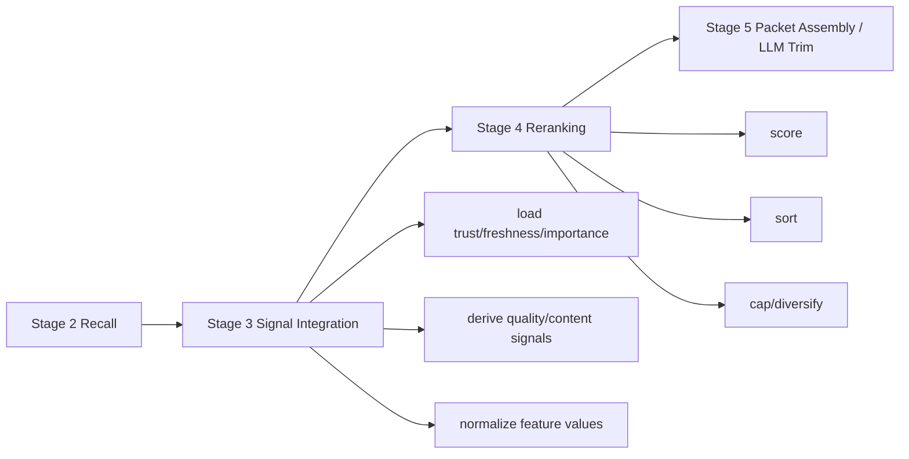

# Retrieval Signal Integration Plan — Stage 3

## Purpose

Stage 3 is the retrieval path's feature boundary. It accepts the bounded
`CandidatePool` from Stage 2 and the frozen `ParsedQuery` from Stage 1, then
emits a `SignalEnrichedCandidatePool` for Stage 4 reranking.

Stage 3 answers: **what do we know about this candidate?** It does not decide
final order, packet placement, sufficiency, or recommendation.

This governing file defines scope, vocabulary, invariants, and phase order.
Implementation details live in the phase files:

1. [Phase 1: Signal Contract and Defaults](retrieval-signal-integration-plan-phase1.md)
2. [Phase 2: Maintenance Signal Loading](retrieval-signal-integration-plan-phase2.md)
3. [Phase 3: Summary and Quality Gate](retrieval-signal-integration-plan-phase3.md)
4. [Phase 4: Passive Feedback Evidence Model](retrieval-signal-integration-plan-phase4.md)
5. [Phase 5: Integration Assembly and Instrumentation Payload](retrieval-signal-integration-plan-phase5.md)

---

## Boundary



```text
RecallCandidate + ParsedQuery
  -> NoteSignals
  -> SignalEnrichedCandidate
```

Stage 3 owns:

- batch loading `note_trust`, `note_freshness`, and `note_importance`
- batch loading `note_passive_feedback` when Maintenance migration 026 exists
- computing query-conditioned type priors
- computing freshness score and freshness multiplier
- classifying summary/control-signal quality
- setting `quality_pass`
- carrying materialized passive-feedback state forward for logging/training
- preserving wiki/archive structural separation

Stage 3 does not own:

- final score or rank (Stage 4)
- packet slots and body hydration (Stage 5)
- retrieval state and recommendation (Stage 6)
- explicit outcome capture (runtime)
- promotion, freshness recomputation, or trust recomputation (ingestion maintenance)

---

## Glossary

- **NoteSignals**: normalized per-candidate signal bundle consumed by Stage 4.
- **SignalEnrichedCandidate**: original recall candidate plus `NoteSignals`.
- **Summary/control signal**: compact text surface used to infer whether the
  candidate contains meaningful guidance. May be human-authored summary, gene
  string, extracted action summary, or other compact promoted metadata.
- **Quality gate**: boolean and reasons indicating whether a candidate has enough
  content signal to be trusted as a primary retrieval result.
- **Exposure feedback**: weak evidence that a note was retrieved or emitted.
- **Outcome feedback**: stronger evidence that a note was useful or misleading.
- **Passive feedback**: confidence-weighted evidence inferred from raw sessions,
  promoted notes, task outcomes, incidents, contradictions, supersessions, or
  LLM-mediated attribution. Retrieval never infers it directly. Maintenance
  materializes it in `note_passive_feedback`.
- **`note_passive_feedback`**: maintenance-owned table populated from two paths:
  `extraction_inline` attribution stored in `promotion_decisions` and
  `maintenance_post_hoc` cross-episode derivation.

---

## Signal Contract

For each wiki candidate, Stage 3 computes:

| Signal | Source | Default | Notes |
|--------|--------|---------|-------|
| `trust_score` | `note_trust.usefulness_score` | `0.0` | Outcome-derived usefulness |
| `freshness_score` | `1.0 - staleness_score` | date fallback | Higher is fresher |
| `freshness_state` | `note_freshness.freshness_state` | `fresh` | Used by assessment and multiplier |
| `importance_score` | `note_importance.importance_score` | `0.0` | Structural/maintenance priority |
| `type_prior_score` | `TYPE_PRIORS[query_type][note_type]` | `0.0` | Query-conditioned type fit |
| `summary_quality` | summary/control signal | `none` | `none`, `title_only`, `weak`, `useful` |
| `quality_pass` | derived | `False` | False for empty or non-actionable candidates |
| `quality_reasons` | derived | `[]` | Explanatory codes for Stage 5/6 warnings |
| `freshness_multiplier` | state x temporality | `1.0` | Precomputed for Stage 4 |
| `passive_feedback_state` | `note_passive_feedback.feedback_state` | `none` | Highest-confidence materialized passive label |
| `passive_feedback_confidence` | `note_passive_feedback.confidence` | `0.0` | Confidence of selected passive label |

Archive candidates receive a smaller signal set: archive identity, rank, raw
score, excerpt/summary quality, source provenance, and passive feedback state.
Archive candidates remain structurally separate from wiki candidates.

---

## Passive Feedback Position

Most agents will not call back with explicit `useful_id` or `misleading_id`.
Therefore Stage 3/4 must not depend on polite feedback. The normal loop is:

```text
retrieve call
  -> query_id + ranked hits logged
  -> agent uses packet silently
  -> full session becomes raw material
  -> extraction/promotion creates candidates/notes/outcomes
  -> maintenance derives feedback evidence with confidence grades
```

Stage 3 consumes the current trust/freshness consequences of that loop and the
materialized `note_passive_feedback` rows written by maintenance when the table
exists. It does not read raw sessions,
`promotion_decisions.retrieval_attribution_json`, or extraction candidates
directly.

Evidence is intentionally broad upstream. Extraction may emit
`retrieval_attribution` when a session's `## Memory Context` block is reused,
paraphrased, corrected, contradicted, or superseded. Maintenance then converts
that evidence into passive labels:

- `extraction_inline`: emits only `passive_used_likely`; no outcome-quality labels.
- `maintenance_post_hoc`: may emit `passive_used_likely`,
  `passive_useful_likely`, or `passive_misleading_likely`.

---

## Non-Negotiable Invariants

- Stage 3 input is the frozen `ParsedQuery` and Stage 2 `CandidatePool`.
- Stage 3 performs batch reads only. No DB writes.
- Stage 3 does not inspect full note bodies for ranking decisions. Later
  direct-retrieve inspection hydration may read selected `body_path` files after
  ranking, but that output-only path must not feed back into Stage 3 signals.
- Summary/control-signal quality is a separate feature, not hidden inside score.
- `quality_pass=False` must not erase the candidate; Stage 5/6 need warnings.
- Missing maintenance rows use explicit defaults and reason codes.
- Wiki and archive lanes remain separate.
- Passive feedback metadata is read-only. Maintenance is the sole writer of
  `note_passive_feedback`; Stage 3 may consume rows but never derive or write
  them.

---

## Public API

Planned module:

```text
src/second_brain/signal_integration.py
```

Primary entry point:

```python
integrate_signals(
    config,
    parsed_query,
    candidate_pool,
    *,
    connection,
) -> SignalEnrichedCandidatePool
```

---

## Completion Gate

Stage 3 completion gate:

1. `retrieval.py` no longer loads trust/freshness/importance inline. Done.
2. Typed `NoteSignals` and `SignalEnrichedCandidatePool` exist. Done.
3. `importance_score` is loaded and carried to reranking/logging. Done.
4. Summary/control-signal quality and `quality_pass` are tested. Done.
5. Passive feedback vocabulary is documented and represented in signal models.
   Done: Stage 3 loads `note_passive_feedback` when available and falls back to
   `none` / `0.0` before Maintenance migration 026.
6. Archive candidates remain structurally separate. Done.

---

## Reference

**Roadmap:** [retrieval-signal-integration-roadmap.md](retrieval-signal-integration-roadmap.md)  
**Overall roadmap:** [retrieval-development-roadmap.md](retrieval-development-roadmap.md)  
**Governance:** [RETRIEVAL-PATH-GOVERNANCE-DESIGN.md](RETRIEVAL-PATH-GOVERNANCE-DESIGN.md)
